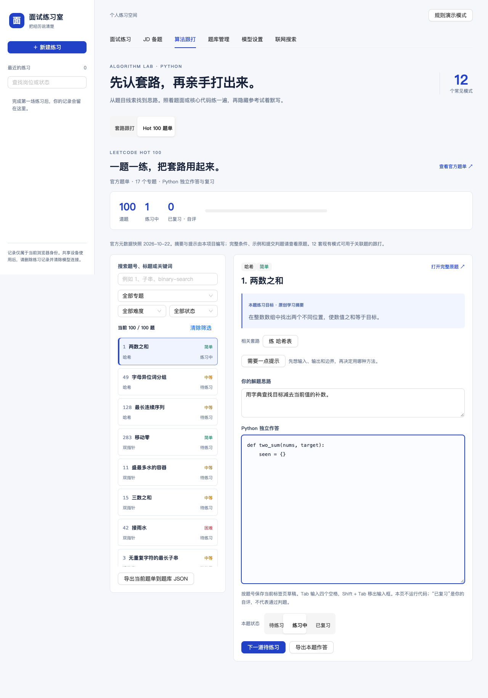

# 面试练习室

围绕简历和目标岗位准备文本面试，也可以用 LeetCode Hot 100 练习 Python 算法。支持 JD 提前备题、按时长规划面试、逐题反馈、报告复盘，以及题面和核心代码跟打。

默认提供规则演示，无需模型密钥即可体验流程。真实 AI 面试和 JD 备题需要启用自己的模型连接，或由部署方配置默认模型。演示评分不代表专业能力评价。

## 功能入口

应用顶部的标签页对应以下功能。

| 入口 | 可以做什么 |
| --- | --- |
| 面试练习 | 上传简历、填写 JD，按候选人级别、轮次与时长规划面试，作答后查看逐题 QA 和三维报告。 |
| JD 备题 | 只提供岗位与 JD 即可预生成题单，核对原文依据、编辑要点，再保存到题库或带入练习。 |
| 算法跟打 → 套路跟打 | 按关键词识别候选套路，查看 Python 例题代码，照打或隐藏参考默写，逐行核对。 |
| 算法跟打 → Hot 100 题单 | 按专题、难度和练习状态选题，独立写 Python、记录思路、查看提示与复习。 |
| 题库管理 | 自建、编辑、检索题目，导入公开 LeetCode 题目或 JSON，选择严格、混合或灵活改编模式。 |
| 模型设置 | 配置 OpenAI-compatible 服务，读取模型列表、测试连接并启用。 |
| 联网搜索 | 配置 Tavily 或 Firecrawl v2，按场次确认搜索关键词并保留来源。 |

<details>
<summary>查看 Hot 100 练习界面</summary>



</details>

## 本地启动

需要 Node.js 22.16 或更高版本、pnpm 12.11.2，以及可运行 Docker Compose 的环境。PostgreSQL 和 Redis 运行在容器中，Web、API、Agent 与 Worker 在本机运行。Python 3 用于内置算法模板的测试，网页本身不执行 Python。

在仓库根目录安装依赖和项目自带的 Bun 运行时。

```sh
pnpm install --frozen-lockfile --ignore-scripts
pnpm runtime:setup
```

首次启动时，从示例创建环境文件。已有 `.env` 时跳过此步，保留原配置。

```sh
cp .env.example .env
```

启动数据库和应用。

```sh
docker compose -f infra/compose.yaml up -d --wait
pnpm dev
```

打开 [面试练习室](http://localhost:5173)。默认端口如下，启动前确认没有冲突。

| 服务 | 本机端口 |
| --- | --- |
| Web | 5173 |
| NestJS API | 3000 |
| Agent | 4111 |
| PostgreSQL | 55439 |
| Redis | 56389 |

启动后可通过 `http://localhost:3000/api/v1/health` 检查 API 状态。

首次创建开发数据库卷时，Compose 自动运行 [数据库迁移](infra/migrations) 和 [开发角色授权](infra/init-dev.sql)。已有数据卷不会重新执行初始化。升级旧库时，使用具备迁移权限的管理员连接运行迁移，再核对新增表的角色授权。

```sh
MIGRATION_DATABASE_URL='替换为管理员数据库连接地址' pnpm db:migrate
```

业务表只授权给 app 角色，Agent 角色只访问 `agent_runtime`。不要通过扩大 Agent 权限解决业务表授权问题。

## 准备与完成一次面试

1. 在顶部 **模型设置** 填写接口根地址、API Key 和模型名。可先读取模型列表或测试连接，再保存并启用。使用规则演示时可以跳过配置。
2. 在 **面试练习** 上传简历，检查提取预览后确认使用。也可以直接粘贴简历与项目经历。
3. 填写目标岗位、岗位描述和练习重点。选择候选人级别、面试轮次、时长、回答长度和题库模式，核对计划后开始。
4. 逐题作答，查看反馈。生成失败时保留已接受的作答，可检查连接后显式重试，或取消练习。
5. 完成后查看技术能力、沟通表达、综合素质和逐题 QA。导出 Markdown 或 JSON，也可用相同资料重新练习。

模型连接默认保留 24 小时，可选择保留 30 天。完整的 `/chat/completions` 地址会规范化为根地址。本地模型地址指 Agent 所在机器。测试连接可能产生供应商费用，短探测不保证后续生成质量。

每场面试固定模型快照。切换连接只影响新面试；旧连接过期或被清除后，需要重新启用连接再显式重试。系统不会在失败时自动降级到其他供应商或规则演示。

### 简历与面试规划

- 简历支持 PDF、DOCX、TXT 和 Markdown，文件最大 5 MB。PDF 提取前 20 页，扫描件需要先做 OCR，旧 DOC 需先转换。
- 提取在本地服务的独立进程中完成。预览最多 64000 字，提交面试的简历最多 16000 字，确认前可校正文本。原始文件不长期保存。
- 候选人分为实习、校招和社招。轮次包括一面、二面和 HR 面，问题难度与数量随参数调整。
- 面试总时长为 5 至 120 分钟。HR 面最多 30 分钟，并禁用编程题。单场最多 30 题，计划包含开场、问答、可选编程和反问。
- 编程题仅在求职者模式、技术岗且非 HR 面时启用，从匹配的题库中选择原题。服务端接收代码与思路供模型评价，不执行代码。

提交作答后，服务端根据已完成环节与近期问答耗时动态重规划。等待作答时也可调整总时长和后续回答长度，当前题、已完成 QA 和草稿保持不变。时间预算到达后只评估已接受的当前回答，不再展示新题。

面试输入和未提交作答保留在当前标签页，刷新可恢复。已接受的作答与面试任务保存到服务端，断开页面不会丢失。侧栏展示最近 50 场练习，可按岗位或状态查找。

### 按 JD 提前备题

在 **JD 备题** 中填写岗位名与 JD，生成 3 至 12 道题，无需先填简历。选择实习、校招或社招，以及面试轮次和岗位方向。技术面生成技术问答，HR 面与非技术岗生成行为问答；面试中的编程题仍从题库安排。

每题保留 JD 原文依据、回答要点和追问，区分必备项与加分项。编辑、校正分类并勾选题目后，可批量入库、导出 Markdown，或选择 **保存并带入练习**。带入使用严格模式并保留已有简历草稿，实际题量仍受面试计划限制。

从面试资料中的 **根据 JD 提前备题** 进入时，会携带当前岗位、JD 与规划参数。直接打开 JD 备题标签页时，恢复独立备题草稿。生成失败保留已有题单，生成中刷新需要重新发起。备题只向当前模型发送该页岗位、JD 与参数，不自动触发联网搜索。

### 管理题库与联网资料

题库支持自建、编辑、删除、检索，以及公开 LeetCode 链接和 JSON 批量导入。JSON 格式示例可在导入页查看，每次最多 100 题、5 MB。LeetCode 导入按地区与 slug 去重，不使用账户 Cookie，也不导入付费题。上游不可用时可改用 JSON。

每个浏览器身份最多保存 500 题，包含内置题。批量操作超额时整批回滚。面试固定题库快照，编辑题库不改变旧面试。

| 题库模式 | 使用方式 |
| --- | --- |
| 严格 | 保持原题，题量受匹配库存限制。 |
| 混合 | 交替使用原题和生成的问答题。 |
| 灵活改编 | 按候选人难度调整题库材料，也可生成问答题。 |

开场、反问和编程始终使用原题。报告保留题目来源、原作答、原文依据和维度评分；HR、非技术岗、开场和反问的技术能力显示不适用。

在 **联网搜索** 中保存 Tavily 或 Firecrawl v2 连接后，还需为每场面试启用搜索，并确认 2 至 200 字的关键词。只外发确认的查询，不自动发送简历、JD 或作答。首次取得的来源固定用于本场并进入报告。搜索失败时可重新配置连接，或明确关闭本场搜索后重试。

## 练习 Python 算法

### Hot 100 独立作答

打开 **算法跟打 → Hot 100 题单**。内置的是从 [LeetCode 官方 Hot 100](https://leetcode.cn/studyplan/top-100-liked/) 提取的 **2026-10-22 快照**，共 100 题、17 个专题。

1. 按专题、难度、题号、标题或练习状态筛选题目。
2. 查看本项目原创学习摘要，在原站核对完整题面、限制和示例。
3. 独立编写 Python 与解题思路，需要时展开提示。
4. 自评为待练习、练习中或已复习，再继续下一道待练习题。

代码、思路与自评按题号保留在当前标签页。可导出单题作答，也可将当前筛选的题单导出为 JSON，再到 **题库管理** 导入。重复导入按 slug 跳过。

题单提供学习目标与提示，当前并非一百份完整标准题解。已有模式仅在相关题目显示跟打入口，其余题目明确显示尚无模板。完整题面和提交判题保留原站入口，**已复习** 是用户自评。

### 套路跟打与默写

打开 **算法跟打 → 套路跟打**，粘贴题面或关键词，或从编程题库带入。页面显示命中词和多个候选模式，可手动选择。每个模式包含适用条件、步骤、易错点、复杂度和一份 Python 例题代码。

现有 12 种模式为哈希表、相向双指针、滑动窗口、前缀和加哈希计数、二分查找、单调栈、BFS、回溯、0/1 背包、堆 Top K、并查集和拓扑排序。关键词仅辅助识别，模板解决标明的例题，套到自己的题目时仍需核对条件与输入输出。

选择 **核心代码跟打** 或 **题面跟打**，照着参考输入，也可隐藏参考默写。核对时显示首次差异的行列与逐行结果。Tab 在代码区插入四个空格，Shift + Tab 移出输入框。比较保留空格、缩进和末尾换行，统一换行格式，并按 Unicode 码点处理中文与 emoji。

最近 20 个跟打对象的草稿分别保存。目标原文改变时不套用旧输入，编辑带入的题面不会写回题库。Hot 100 独立作答与跟打草稿分别保存，关闭标签页后不保证保留，也不跨设备同步。

算法练习无需模型或搜索连接，不外发题面和输入代码。网页不执行用户代码，跟打一致与自评完成均不代表通过算法判题。

## 使用项目 skill 与题单工具

| 项目 skill | 用途 |
| --- | --- |
| [algorithm-practice](skills/algorithm-practice/SKILL.md) | 基于同一份 Hot 100 数据选题、分层提示、讲解 Python 核心代码和复盘解法。 |
| [software-factory](skills/software-factory/SKILL.md) | 根据 spec 选择能力、生成设计上下文和配置索引，并依据可重放证据复盘项目。 |

可让开发助手读取对应 `SKILL.md`，或在本项目中请求使用 `$algorithm-practice`。项目 skill 没有安装到全局，也不等于网页已经接入新的在线 AI 服务。

题单工具与网页共用数据，安装依赖后可在仓库根目录运行，无需先启动 Web 或数据库。

```sh
pnpm algorithm list --group 哈希 --difficulty easy
pnpm algorithm list --query 子串
pnpm algorithm show 239 --hint
pnpm --silent algorithm export-bank --group 回溯 > hot100-backtracking.json
```

`list` 和 `show` 输出来源、快照日期及官方元数据的 SHA-256。哈希只覆盖元数据，不覆盖原创提示或个人作答。`export-bank` 只输出符合现有导入契约的 `questions`。

官方元数据位于 [hot100.json](packages/interview/data/hot100.json)，原创学习卡位于 [hot100-lessons.ts](packages/interview/src/hot100-lessons.ts)。需要刷新题单时，先保存官方学习计划 HTML，再运行提取和对应测试。

```sh
pnpm algorithm:update --html path/to/studyplan.html
pnpm exec vitest run tests/hot100.test.ts
```

解析失败保留旧快照，题号变化需要同步原创学习卡。页面和工具的共同实现位于 [hot100.ts](packages/interview/src/hot100.ts)。

## 配置与数据归属

配置项与校验规则见 [配置模块](packages/config/src/index.ts)，示例见 [.env.example](.env.example)。真实环境文件、密钥和个人简历不进入版本库、公开验收报告或经验库。

| 配置 | 用途 |
| --- | --- |
| `MODEL_MODE=demo` | 规则演示，仅用于开发体验，生产配置拒绝启用。 |
| `MODEL_MODE=live` | 使用部署方默认模型，Agent 需同时配置 `LLM_MODEL=provider/model` 与 `LLM_API_KEY`，兼容接口可设置 `LLM_BASE_URL`。 |
| `MODEL_MODE=disabled` | 仅使用用户自带连接，未启用连接前禁止开始面试或生成备题。 |
| `CUSTOM_MODELS`、`MODEL_ALLOWED_HOSTS`、`ALLOW_LOCAL_MODELS` | 控制自带模型连接与允许访问的主机。 |
| `SEARCH_ACCESS`、`SEARCH_ALLOWED_HOSTS`、`ALLOW_LOCAL_SEARCH` | 控制搜索连接与允许访问的主机。 |

模型和搜索连接在开发环境默认开放，生产环境默认关闭。生产自带连接需显式启用、配置主机允许列表并使用 HTTPS，默认拒绝私网出站。本地模型访问仅在受控部署中开放。

模型与搜索密钥经 API 授权转交 Agent，保存在 Agent 数据库的 AES-GCM 加密字段中。业务数据库角色不能读取密钥，报告、导出和浏览器持久存储也不包含密钥。清除连接会使旧面试对应连接失效，但不删除已经取得的搜索来源。更换内部服务 token 后，已有加密连接需要重新保存。

应用使用签名浏览器身份，尚无正式账号、组织管理或跨设备同步。清除 Cookie 会失去原身份的访问能力。共享设备使用后，应删除练习并清除连接与本地草稿。删除练习会通过持久任务清理派生生成结果。

每个身份最近 24 小时最多保留 20 场新建会话，删除会话会降低计数。该限制不是公开服务的全局成本控制。取消会话也不保证第三方停止计费。

## 开发结构

前端使用 React 19、Vite、TypeScript、Ant Design 与 TanStack Query。API 和 Worker 使用 NestJS，业务库使用 PostgreSQL 与 Drizzle，任务使用 BullMQ 与 Redis。Agent 独立运行于 Bun，使用 Hono 与 Mastra。依赖版本由 `pnpm-lock.yaml` 锁定。

| 目录 | 职责 |
| --- | --- |
| `apps/web` | 面试、备题、题库、模型设置和算法练习界面。 |
| `apps/api` | 身份与请求授权，业务记录读写，题库和材料管理。 |
| `apps/agent` | 模型调用、评估、连接和搜索，仅写入 `agent_runtime`。 |
| `apps/worker` | 持久任务执行、重试、取消竞争与删除清理。 |
| `packages/contracts` | 跨服务共享的 Zod 契约。 |
| `packages/interview` | 面试规划、报告、算法模式与 Hot 100 题单。 |
| `packages/database`、`packages/jobs` | 业务数据库与任务基础能力。 |
| `packages/factory` | spec 解析、能力选择和设计上下文生成。 |
| `infra` | 开发环境、测试数据库和迁移。 |
| `skills` | 算法练习与软件工厂项目 skill。 |

新增能力先修改 `app.spec.yaml`，再解析计划和生成上下文。

```sh
pnpm factory plan --spec app.spec.yaml
pnpm factory:docs
pnpm factory:check
```

工厂维护能力与设计上下文，配置登记不代表业务实现。当前项目不把单项目验收自动晋升为跨项目规则。

## 验证

默认检查需要已安装依赖，Python 模板测试还需要本机可执行的 `python3`。

```sh
pnpm typecheck
pnpm build
pnpm test
```

集成测试使用独立临时数据库，端口为 55440。以下清理命令只针对测试环境。

```sh
docker compose -f infra/compose.test.yaml up -d --wait
RUN_INTEGRATION=1 pnpm test
docker compose -f infra/compose.test.yaml down --volumes
```

浏览器测试需要另一个终端中的 `pnpm dev` 保持运行，并安装 Google Chrome。测试使用独立身份与本地模型协议 fixture，不调用真实付费账号。

```sh
pnpm test:e2e
```

公网 LeetCode 导入测试默认跳过，需显式设置 `RUN_PUBLIC_IMPORT=1` 才会访问上游。最新可查验记录为 **2026-10-22**，默认测试 93 项通过、58 项按环境开关跳过，Hot 100 的 4 个 Chrome 场景通过，并已验证一百题导入和重复去重。完整范围和跳过项见对应验收记录。

| 验收记录 | 覆盖范围 |
| --- | --- |
| [Hot 100](docs/evidence/hot100-acceptance.md) | 官方数据快照、独立作答、恢复、题库导入及 skill 前向试用。 |
| [算法跟打](docs/evidence/algorithm-acceptance.md) | Python 模板边界用例、文本比较、草稿和桌面与手机交互。 |
| [JD 备题](docs/evidence/jd-acceptance.md) | 原文依据、编辑与恢复、批量入库和严格模式带入。 |
| [面试能力扩展](docs/evidence/extension-acceptance.md) | 简历、搜索、规划、题库、报告与权限隔离。 |

## 当前范围与相关文档

当前交付覆盖文本面试和本地算法练习。RAG、实时语音、用户代码执行和在线判题尚未接通。Hot 100 学习进度由用户自评，模型评分质量及真实供应商计费仍需在实际连接中核验。

生产前端产物位于 `dist/web`。公开部署还需要 HTTPS 反向代理、按服务注入凭据、数据备份和全局成本控制，完整生产镜像组合尚未验收。

- [项目需求与能力矩阵](docs/generated/03-CAPABILITY-MATRIX.md)
- [持久任务设计](docs/adr/0001-persistent-interview-execution.md)
- [模型接入设计](docs/adr/0002-model-connections.md)
- [软件工厂使用记录](docs/software-factory.md)
- [JD 备题调研](docs/research/jd-preparation.md)
- [算法模式调研](docs/research/algorithm-practice.md)
- [GitHub 参考与许可](docs/research/github-interview-agents.md)

项目独立实现。参考项目的许可与借鉴范围见上述调研记录。
