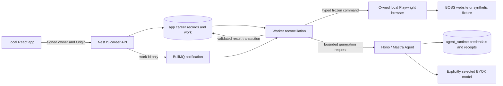

# Local candidate BOSS career workflow

Status: the local implementation is present. Authenticated BOSS compatibility is unverified, and real outbound delivery remains disabled. Requirements remain `app.spec.yaml`, REQ-025–034. The sections below retain the approved design contract and its original planned interface sketches. Use [the operating guide](../boss-workflow.md) for current setup and [the functional review](boss-functional-review.md) for acceptance evidence. Existing interview, JD-only preparation, resume extraction, and model connection flows retain their documented boundaries.

## Scope and delivery authority

The candidate manually starts a local search, reviews evidence and final greetings, then approves up to ten postings for conversation initiation and delivery of one selected original resume. A task reads at most thirty distinct postings. The targets are full stack **or** Agent development, Guangzhou **or** Shenzhen, with a monthly salary range upper bound of at least CNY 18,000. AI application work is a preference after match quality. Employer recruiting, schedules, automatic resume rewriting, ongoing recruiter responses, and CAPTCHA/access-control bypass are out of scope.

Implementation order is a user constraint: GPT-6.1-sol authors this shared specification, DeepSeek workers implement the approved design, then GPT-6.1-sol checks functionality. The orchestrator owns model routing and review. No real BOSS submission is authorized by this design artifact; the in-product approval described below must precede each exact batch. A synthetic fixture demonstrates software behavior, never real BOSS compatibility or real candidate history.

## Current seams and deliberate extensions

| Existing source | Observed behavior | Planned use/change |
| --- | --- | --- |
| `apps/api/src/auth.ts`, `main.ts` | Signed anonymous HttpOnly identity; server assigns owner; write Origin check | Retain authority for every career, resume, browser-control, download and preparation request. Other owners see 404. |
| `apps/api/src/resume.ts`, `resume-worker.mjs`, `apps/web/src/resume-upload.tsx` | PDF/DOCX/TXT/MD, 5 MB; bounded extraction, editable text; bytes discarded | Preserve `/resumes/import` compatibility; add persistent version endpoints using the same parser and private original bytes. |
| `packages/contracts/src/preparation.ts`, `packages/interview/src/preparation.ts`, `apps/agent/src/preparation.ts` | JD-only 3–12 questions; exact JD quotes, difficulty/category validation; no resume | Add an explicitly discriminated personalized request/result with JD and resume sources, exactly ten career questions; preserve old callers and existing validator semantics. |
| `apps/api/src/bank.ts`, `packages/contracts/src/bank.ts`, `interviews.ts` | Transactional owner batch save, request dedup, 500-question cap; strict material snapshots | Extend provenance for personalized questions and reuse atomic save/strict snapshot behavior. |
| `packages/database/src/schema.ts`, `apps/worker/src/worker.ts` | `app.jobs` belongs to interview async generation, leases and attempts guard result commits | Keep interview tables untouched in meaning. Add career entities and bounded work records; reuse SQLite truth/BullMQ notification and reconciliation, not interview send-retry semantics. |
| `apps/agent/src/models.ts`, `connection-cipher.ts`, `server.ts` | Agent owns encrypted BYOK connections and model resolution | Add match/greeting/personalized preparation internal operations. No browser credentials or side-effect tools in prompts. |
| `apps/web/src/navigation.ts`, `main.tsx`, `primary-navigation.tsx`, `api.ts`, `preparation-panel.tsx` | Recoverable hash routes, Ant Design, TanStack Query, preparation/bank bridge | Add a career area and persistent resume library; reuse layout, query and editor patterns. |
| `packages/factory/src/runtime-check.ts`, `apps/api/src/runtime-capabilities.ts` | Build/start requires exact spec/runtime capability equality | Keep the gate. This spec-only state intentionally fails it until runtime is implemented and checked. Do not add a registry entry merely to make the check green. |

The repository manifest requires Node >=22.16. The inspected lock resolves TypeScript 5.9.3, React 19.3.0, Nest 12.1.3, Playwright 1.64.0 and Bun 1.4.3; use the actual lock, not version guesses. The current Playwright runtime is test-only; implementation must add an explicit production Playwright dependency at the lock-compatible version if importing it from Worker. No runtime/package edit is part of this stage.

## Service ownership and trust



API and Worker share a career business module as the only writers of career `app` tables. Browser DOM extraction returns data; it never writes business records. Worker owns local browser processes and private profile paths. Agent writes only `agent_runtime` and generates content; it cannot send on BOSS. All public requests go through NestJS. No direct UI-to-CDP, UI-to-Agent, daily-browser cookie import, or browser credentials in app snapshots. Internal Agent calls retain service authentication, bounded timeouts and owner-bound model resolution.

JD, resume, company text, page DOM and model outputs are untrusted data. They cannot alter the target policy, tool permissions, approval, retry limits or navigation allowlist. Use shared Zod schemas with inferred/branded IDs at boundaries, discriminated state variants, and exhaustive transitions. Parse public input once at the controller, browser observations once at the adapter boundary, and provider output once at the Agent boundary; perform cross-source provenance validation in the shared domain validator at receipt acceptance. Type trusted internal calls; do not copy field-by-field validators into UI, gateway and Worker. Authorization, hash/version checks, transactional dedup and external-effect preflight remain at their actual ownership boundaries.

## Private local storage and resume versions

Planned local configuration: `CAREER_LOCAL_DATA_DIR` shared by local API/Worker, defaulting to a directory under the operating user's application-data directory outside the repository and web root. Worker browser engine configuration is `BOSS_BROWSER_ENGINE=patchright|moli|playwright`, defaulting to `patchright`; each engine keeps its own private profile directory because a Patchright Chrome profile, a Moli profile and a Playwright build are not interchangeable. `BOSS_MOLI_EXECUTABLE` is only read by the legacy `moli` engine and is resolved without a shell. These are planned runtime config additions, not registered working settings. Store no keys in environment examples. Run with private directories (0700), files (0600), process umask 077; generated UUID path segments and owner-derived opaque directories only. Reject symlinks/traversal and untrusted download paths; filenames are display metadata, never path components. Fail clearly if permissions, storage or browser prerequisites are unavailable.

A staged upload stores the original bytes privately, hash, MIME/type, filename, extraction text and warnings. Reuse extraction size/type/timeout bounds. A staging record belongs to the signed owner and expires after 24 hours if not saved; a durable cleanup sweep handles orphans and partial uploads. Save an immutable `ResumeVersion` with `{id, owner, label, originalFileId, attachmentSha256, text, textSha256, createdAt}`. Source text uses LF line endings and is otherwise preserved exactly, max 64,000 characters. The upload must extract valid text; scanned/encrypted/unsupported files retain existing explicit errors. Display parser truncation/page warnings and require acknowledgment before saving a version. Do not silently truncate for matching/preparation.

The preview allows correcting extraction; saving creates a new immutable version referencing the exact original attachment. Corrections do not rewrite the original. Show both corrected text and downloadable original before saving/approval so the user can verify the pair; a changed resume document requires a new upload. Label edits may change library metadata but never version text/bytes. A task chooses exactly one saved version before search; all matching, greeting facts, preparation and sends use that version's hashes. The model receives text, never local paths or binary attachment bytes. A site that cannot accept that original type/size must show an attachment limitation, not silently substitute another format or existing online resume.

Deletion is an explicit owner command with impact preview. Deleting a version first cancels queued/running referencing tasks, revokes unstarted approved actions and stops/quiesces the browser actor. Already dispatched effects cannot be undone; preserve honest sanitized outcomes. Delete private original bytes when the last version reference is removed, text snapshots, matches, greetings, career preparation, related runtime receipts and career-derived bank provenance/material containing that resume. Remove derived bank questions and sanitize or delete strict interview snapshots containing deleted resume sources through the existing interview deletion/purge boundary; show this impact before confirmation. Retain independent JD-only questions, other resume versions and unrelated interviews. Keep only owner-scoped posting identity/effect tombstones without personal text or greetings for dedup. Use persistent deletion work and retry cleanup; late generation results cannot resurrect deleted material. Clear-session is separate from deleting task history or resumes. No raw files, private paths, cookies, personal preparation or page screenshots enter public evidence/experience libraries. Career data is sensitive in workspace backup rules and excluded by default; credential state is never exportable.

## Persistent entities and invariants

Names below are planned additions. Avoid using `jobs` to mean recruitment postings. SQLite constraints and transactions own identity and concurrency; JSON is for validated snapshots, not a substitute for unique keys.

| Entity | Essential fields and constraints |
| --- | --- |
| `app.resume_files`, `app.resume_versions` | Owner, opaque file id, private storage key, original name/type/byte count, attachment hash; immutable version text/hash and file FK. Owner checked for every task, download and delete. Shared-file deletion uses reference count/transaction, not filename matching. |
| `app.career_browser_sessions` | Unique owner + site `boss`; public state, engine, opaque private profile handle, generation, active task id, browser process identity. No cookies, tokens, CDP URL or raw profile path in API responses. A partial unique constraint allows one active browser task per session. |
| `app.career_tasks` | Owner, selected resume version/hashes, frozen search policy/blacklist, explicitly authorized model source snapshot (nonsecret), revision, state/phase, read count, pause reason, created/updated times. Browser session FK; immutable task inputs. |
| `app.career_postings` | Unique `(owner, site, site_posting_id)`; canonical validated URL, latest title/company/location/salary and timestamps. Owner partition prevents cross-user disclosure. A recruiter id/company name/title alone is insufficient identity. |
| `app.career_task_postings` | Unique task + posting; immutable JD/read snapshot/hash, native-filter evidence reference, parsed hard-filter decisions, exclusions, uncertainty, match and greeting draft revision. Preserve every observed disposition including dedup. |
| `app.career_batches`, `app.career_batch_items` | Owner, task, approval request id/hash, approved task/draft revision, resume version/hashes, model attribution, approvedAt; 1–10 exact unique postings, snapshot hashes, final greeting strings/hashes. Immutable after approval. |
| `app.career_applications`, `app.career_effects` | Unique owner + site + posting application/reservation across tasks; links frozen batch. Separate conversation and attachment phase/effect records, before-dispatch intent, confirmed observations, reason and timestamps. At most one unresolved or completed effect per posting/phase. |
| `app.career_preparations` | Owner, task/posting/resume/JD hashes, generation/revision, model source, independent status, original validated result plus editable revision/provenance and bank-save request ids. Unique generation key prevents duplicate automatic ten-question sets. |
| `app.career_work` | Bounded scan, delivery, preparation or purge work with task/item FK, request hash, revision, attempts, leaseUntil, leaseGeneration, status and failure. Persistent truth; BullMQ carries only work id. Separate generation retries from external effects. |
| `app.career_commands` | Unique `(owner, requestId)`, command kind, request hash, accepted revision/result id. Same id + same hash returns accepted result; a different payload returns 409. |

Existing `app.jobs` has a non-null interview FK and interview-specific payload; do not overload it. Reuse `packages/jobs/src/queue.ts` connection/options by exposing a small named career notification queue, plus the existing reconciliation pattern. Do not introduce a generic workflow engine, parallel queue framework or scheduler. Domain-specific `career_work` is necessary for career FKs, frozen approval and per-effect recovery. A task can contain multiple sequential user-approved batches, each at most ten, while its total unique posting reads remain at most thirty.

Stable identity comes from the website posting id in an observed canonical posting link/detail; strip tracking parameters but preserve validated identity. Missing/conflicting ids become `needs_review` and are never auto-approved. Persist reservations/tombstones across tasks, browser resets and task deletions. Confirmed conversation, waiting consent, confirmed attachment and unknown effects are skipped by default. A proven failure before any external action can be retried only through a fresh explicit command; a failed attachment after confirmed conversation retains that conversation and can never initiate it again. No blanket “retry batch” resends completed actions.

## Search and hard-filter decisions

Freeze a task policy containing `roleTargets: ['fullstack','agent_development']`, `cities: ['广州','深圳']`, `salaryUpperMinCnyMonthly: 18000`, `preferAiApplication: true`, `companyBlacklistKeywords`, `maxPostings: 30`, `maxBatchItems: 10`. The two role targets and two cities are OR conditions. A company blacklist is a list of literal, trimmed, nonempty keywords, not executable regex; normalize NFKC/case for matching while retaining the exact original matched span and field. A policy change creates a new task and cannot reinterpret an approval.

Use the BOSS website's native city, salary and position/category controls when available. If the site supports one city/query at a time, iterate city/role searches within one shared thirty-posting budget and deduplicate. Record each search's observed control labels/selected values, URL and bounded visible evidence. Never treat a constructed query URL as proof the filter applied. Re-check controls after navigation. If a supported control fails to apply, pause with an actionable error instead of silently replacing it with a local full-site search.

Salary semantics need post-read verification: `15–25K` qualifies, `18–18K` qualifies, `10–15K` fails. A native `20K+` minimum filter could lose qualifying `15–25K` postings; choose the union of native bands that can include upper >=18K, using a broader native selection if necessary, then parse the visible posting range. Do not claim exact native coverage without observed native band definitions. Preserve raw salary, unit and explicit monthly bounds; `13薪` is metadata and must not convert a low monthly salary into a qualifying one. Negotiable, annual/daily, missing or ambiguous bounds are `needs_review`; do not invent a conversion. Title/JD evidence must establish full stack or Agent software development; sales/HR uses of “Agent” do not qualify. Location outside the two cities fails; ambiguous/remote-only location needs review rather than assumed inclusion.

Hard-filter results are `eligible`, `excluded` or `needs_review`, with reason codes and source spans for each role/city/salary/company/employment decision. Blacklist matches in company name/profile are visible exclusions. Explicit outsourcing, staffing/vendor placement or labor dispatch in observed employer/JD text is excluded. Unknown employment relationship is explicitly `needs_review`; absence of outsourcing keywords is not evidence of direct employment. Show the source used to establish direct employment and any contradictory evidence. The default shortlist includes only eligible, stable-id, nonduplicate postings; reviews can inspect all read records and mark verified facts with an owner-authored note/source. Explicit failing filters cannot be overridden into this task's approval. Unknown effects require reconciliation, never a manual “assume not sent” toggle.

Enforce the thirty distinct-read budget transactionally before opening a new posting detail; revisits for verification do not create new entries. Count failures/unknown detail reads against the reserved identity so repeated extraction failures cannot create an unbounded crawler. Retain card-level exclusions and duplicate counts as observations without spending another distinct-detail slot. Lack of ready results is a failure/paused state, not a successful empty search. No live BOSS selectors, city codes, salary parameter codes or undocumented HTTP mutation endpoints are assumed verified here.

## Model contracts and grounded ranking

Planned schemas live in `packages/contracts/src/career.ts`; inferred types are used across services. IDs are UUID-based semantic brands where different ids could be mixed up. This sketch defines wire semantics, not executable source. Only shared schemas should define the final types.

```text
SourceRef =
  { kind: 'jd', postingSnapshotHash, start, end, quote }
  | { kind: 'resume', resumeVersionId, resumeTextHash, start, end, quote }
SourceText: stored LF-normalized snapshot; offsets are JS UTF-16 [start,end).
Validate start < end, bounds, exact source.slice(start,end) === quote,
matching immutable snapshot/version hashes, and quote limits.

RequirementAssessment =
  { kind: 'supported', priority: 'required'|'preferred', competency,
    jdSources: SourceRef[jd][1..], resumeSources: SourceRef[resume][1..], rationale }
  | { kind: 'gap'|'uncertain', priority, competency,
      jdSources: SourceRef[jd][1..], explanation }
MatchResult = { assessments[1..12], strengths, gaps, uncertainties,
                aiApplication: { value: 'yes'|'no'|'unknown', jdSources },
                modelAttribution }
GreetingDraft = { text, factualClaims: [{ claim, resumeSources, jdSources }],
                  uncertainties, modelAttribution }
```

The Agent receives immutable resume/JD text and hard-filter decisions as data, with no tool permissions. Facts that describe the candidate require resume evidence. Missing skills are gaps or questions, never invented candidate history. Validate structured output, verbatim spans and cross-record hashes; reject fabricated source quotes. Quotes prove source grounding, not truth of all free prose: display the reasoning and require user review, rather than claiming a model verifier guarantees factual accuracy. Greetings contain no generated contact info, availability or salary commitments; use grounded experience plus an invitation to discuss. User edits are final candidate-authored text, displayed verbatim on approval; do not secretly rewrite/re-generate them after approval.

Hard filtering precedes matching. Order eligible postings by grounded required-requirement coverage (supported required / all extracted required), then fewer unresolved required gaps, then grounded preferred coverage. If there are no required requirements, use preferred coverage explicitly and mark the limitation. AI application evidence breaks equal matching tuples; final ties use stable posting identity. Show counts and source-backed reasoning, not an arbitrary “pass score.” No matching cutoff excludes an otherwise eligible job; the user selects the batch. Excluded/review/duplicate records stay visible with reasons and are not disguised as low scores.

Task creation explicitly selects an enabled BYOK connection and confirms that selected resume text and JDs will be sent to that provider. Resolve that owner-bound connection through the existing Agent model boundary and freeze its nonsecret source identity/model. Default/demo fallback is forbidden for this career flow. Expiry, deletion or failure becomes an actionable model failure; no hidden switch to the current active connection, another provider or demo. A user may explicitly bind another connection for a retry of failed generation; keep attempt attribution and invalidate affected unapproved generated drafts. Approval, greetings, resume and postings stay frozen; a preparation-only model rebind cannot change or resend an approved external action. Agent stores credentials encrypted in `agent_runtime`; business snapshots/export contain only provider/model labels and opaque source references.

## Approval, effects, recovery and cancellation

Search task phases are `queued -> searching -> matching -> review`. Phase failure is `failed` with recoverable input; `paused` carries `login_required|verification_required|site_restricted|page_failures|browser_unavailable` and the prior phase. `cancelled` stops new work. Batch state is `approved -> delivering -> completed|completed_with_review`, with `paused` and `cancelled` variants; completion aggregates item outcomes and does not wait for preparation. These are independent task/batch/preparation states, not one optional-field bag. Session state is `absent|starting|login_required|verification_required|ready|restricted|unavailable|clearing` with reason-specific payloads.

Approval command carries `{requestId, expectedTaskRevision, resumeVersionId, items:[{taskPostingId, postingSnapshotHash, greetingDraftRevision, finalGreeting}]}`. API locks task and selected postings/application identities, validates ownership, eligibility, read limit, <=10 unique items, unchanged hashes/version and active-session compatibility, computes a canonical batch digest from server-owned snapshots and final strings, persists immutable batch/items plus application reservations, and enqueues delivery and independent preparation work in one transaction. Concurrent different approvals cannot reserve the same posting twice; same command replay returns its existing batch. The approval page shows exact company, role, city, salary, exclusion/review status, attachment name/hash/version and every final greeting before a deliberate confirm action. This single explicit confirmation starts the exact frozen batch; no second implicit approval inferred from navigation or login.

A changed resume, posting snapshot, selected list or final greeting requires a new approval. Any pre-send site fact that contradicts the frozen recipient/JD/eligibility suspends that item for new review, never updates the frozen approval in place. Profile engine change, account identity change or session reset revokes unstarted delivery authority and requires review again; ordinary login renewal of the same evidenced account can resume only after the user explicitly resumes. Account identity is an opaque locally hashed observed site account marker, not a raw phone number in business snapshots.

Each item has separate effect phases:

```text
conversation: not_started -> dispatching -> confirmed | failed | unknown
attachment:   blocked_by_conversation | not_started
              -> awaiting_consent | dispatching -> confirmed | failed | unknown
```

`failed` requires evidence that the effect did not occur (e.g. a pre-dispatch missing control or explicit site rejection). `unknown` means a dispatched action has no reliable result or the worker crashed after intent. Confirm conversation only from a stable conversation view/message with the expected posting/recipient and visible greeting evidence, or a site acknowledgment whose semantics are verified against the fixture/live page. Confirm attachment only from sent-attachment evidence matching the selected original bytes/version. A click, HTTP 200, disabled button or generic toast alone is insufficient. Do not label “applied” as attachment sent when only conversation was initiated.

If the site requests recipient permission, record `awaiting_consent` and the confirmed conversation separately. Do not poll/reply to the recruiter or auto-send on a later consent event. A later explicit user resume action may check consent and send only the still-approved original attachment; it must not repeat the greeting or initiate another conversation. If no attachment control is available or the selected file cannot be sent, retain communication status and display the limitation/failure honestly. Upload selected bytes through `locator.setInputFiles`/Playwright FileChooser when the native site flow permits. Upload can itself publish a resume to the user's BOSS account and therefore belongs inside the exact approved delivery, never a read/search step. Hash local bytes immediately before upload; verify site file selection/receipt identity. Existing BOSS resume selection is allowed only when the adapter can verify the version via a trusted upload receipt/hash binding or a permitted downloaded-byte hash; a matching filename alone is insufficient. Global BOSS attachment settings must be serialized per session to prevent cross-item/version confusion.

Before each external step, Worker commits an intent/effect id and checks frozen batch, cancellation, session generation and ownership under transaction. The browser actor admits one command at a time for the session, with the currently owned generation and exact effect id. Fence result commits by lease generation and revision. SQLite fencing alone cannot stop a stale browser from clicking: on lease loss, stop admitting commands and close the owned page/process. Before another worker takes over, quiesce/terminate the previous owned process using verified process identity (not PID alone), wait for exit, acquire the exclusive session/profile lock, then launch/reconnect as appropriate. If prior actor/process death cannot be proven, pause `browser_unavailable`; never let lease expiry alone authorize a second browser. Process/profile lock implementation must use mature OS/process/library behavior, not a distributed locking framework. Do not terminate unrelated browser processes.

On restart, pending pre-dispatch work is safe to continue under a valid approval. Any `dispatching` effect becomes `unknown` and is never automatically replayed. Read-only reconciliation may promote unknown to confirmed or proven failed using durable site evidence; if evidence remains ambiguous, leave it suspended. Other approved items may continue after a single unknown. Login/CAPTCHA/site restriction pauses the whole session/batch immediately. Three consecutive broad page-readiness/extraction failures across different approved postings/search views pause the batch as `page_failures`; a successful page read resets this count. A known removed posting is a per-item failure. Generation errors are independent from site failures.

Cancel is idempotent and durable: mark cancellation before stopping admission, revoke unstarted work, stop/close the active owned browser command, and report any already dispatched effect as observed or unknown. A late receipt cannot advance a cancelled batch or resurrect deleted input, but its sanitized external-effect observation may be retained for dedup. Cancellation cannot undo a message or attachment already sent. Retry controls must name the phase and effect history; no global “try again” that conceals possible sends.

## Browser engine and usable human login

Default adapter: the official Node.js `patchright` package (pinned, currently 1.64.2) driving the Chrome installed on this machine through one long-lived headed persistent context: `channel: 'chrome'`, `headless: false`, `viewport: null`, `acceptDownloads: false` and finite default action/navigation timeouts. The explicit open navigates exactly once to one known BOSS job entry page when no page exists or the page has no loaded document; an existing page, including a login or verification page, is only focused and observed. No launch arguments, headers, fingerprint scripts or signatures are added by this project, no daily-browser cookie is imported and no anti-detection tooling is written here. Patchright is a mature npm driver, not a browser framework: the adapter declares only the driver surface it uses, so the Patchright and Playwright type identities meet at one checked boundary instead of an unchecked whole-object cast.

Legacy adapters remain selectable: Moli 1.1.19 started with loopback-only `serve`, explicit private `--profile-dir`, `--layout`, discovered via its own announcement then attached with `chromium.connectOverCDP(...)`; and a headed Playwright persistent context as Moli's disclosed human-window fallback. Do not launch a second browser while claiming to use one. Do not implement raw CDP, a browser framework, a remote desktop or arbitrary page scripting from user/model content. Every engine keeps its own private profile directory under the owner's profile root, one exclusive `proper-lockfile` lease and one controller; the persisted session engine is a database `CHECK` value, so `006-career-browser-engine.sql` widens it and an engine change starts a new session generation that revokes unstarted delivery.

Session check semantics: a check never launches a browser, creates a page, navigates, refreshes, goes back or reopens. It reports the page the actor actually holds, or `absent` when no page is open. Login or verification detection uses the known `/web/passport/zp/security`, `/web/passport/zp/verify` and slider paths plus visible indicators; a frequency or limit pause requires a rendered notice sentence, so a generic error page or a driver timeout is an ordinary page failure and never anti-bot evidence. Only main-frame navigations the actor did not cause are counted, with 6 navigations in 12 seconds or 4 repeats of the same path as local diagnostic thresholds. When a safety page, a rendered limit notice or such a loop is observed, the actor latches a pause: program navigation, clicks and uploads stop, the current page stays open for the human, and only the owner's explicit session check that observes a usable page lifts the latch. Automated readiness checks and the Worker's polls never lift it. Stopping program actions does not stop the site's own JavaScript, and the observation says so instead of promising that a refresh loop ended.

URL and error output boundary: evidence, session details and error summaries keep host and path only. Query strings, fragments and userinfo are dropped, because a safety page or driver error can quote the challenge parameters the user just saw. Cookies, profile contents and raw driver traces are never logged.

Read sources: installed `~/.agents/skills/moli-cdp-server/SKILL.md` and `references/protocols.md`, `moli-webfetch/SKILL.md`, `moli-websearch/SKILL.md` and its CDP guidance, plus installed `moli serve --help`. Official sources fetched during design:

- [Patchright Node.js](https://github.com/Kaliiiiiiiiii-Vinyzu/patchright-nodejs): patched Playwright driver, drop-in API, recommended `channel: 'chrome'` + `headless: false` + `viewport: null` persistent-context setup; Chromium-only patches; Apache-2.0. This does not establish BOSS compatibility.
- [Moli official repository](https://github.com/lexmount/moli): headless engine, Playwright CDP sample, persistence/rendering options. This does not establish BOSS compatibility.
- [Playwright BrowserType](https://playwright.dev/docs/api/class-browsertype#browser-type-connect-over-cdp): CDP is lower fidelity than Playwright protocol; `launchPersistentContext` uses a dedicated user-data directory; concurrent use of the same directory is unsupported.
- [Playwright Locator.setInputFiles](https://playwright.dev/docs/api/class-locator#locator-set-input-files): local file paths or file payloads for native input; completion is not evidence that a website sent the attachment.

Moli is headless and the installed help has no headed-window switch. `--layout` produces rendering, not a human-operable desktop. The existing public probe `/tmp/moli-boss-public-probe.json` returned HTTP 200 and only “加载中，请稍候”; it verified neither job retrieval, login nor sending. No anti-bot bypass or fabricated ready result follows from that probe.

Implementation must run a bounded compatibility spike against the synthetic browser fixture for the default driver: launch, native controls, original file input, profile persistence across a restart, request counting that proves a check does not navigate, safety and limit pages, the navigation loop, interruption and cleanup. Then attempt a read-only public BOSS page only if within the authorized local task. Record unsupported method/readiness evidence. For human login, use the headed Patchright window; if no headed browser can open (e.g. unavailable display), return an actionable unavailable state and no fake healthy fallback.

Session UI: “Open BOSS login/verification” invokes an authenticated Nest command that asks Worker to open/focus only the owned local browser and pause automation. The user handles QR/login/CAPTCHA inside the actual local browser. The app shows session engine, observed state, whether the window is ready, and “I finished; check session.” That button triggers a read-only verification; it cannot assert ready by itself, and only that explicit check may lift a local pause latch. Then “Resume batch” explicitly resumes a matching paused batch. Site restrictions with no available human resolution remain paused. Never collect passwords, OTPs or cookies in application forms. Mobile app UI can monitor/approve/resume, but clearly tells the user to complete login on the host machine; do not promise a browser window on the phone.

“Clear BOSS session” shows affected active tasks, durably pauses/revokes pending delivery, quiesces owned processes, removes the profile/cookie/storage directory, increments session generation and returns `absent`. Cleanup failures stay visible/retryable. Reuse profile only for the same owner and evidenced site account. Browser port allocation and process handles are internal and bounded; session clear never removes unrelated profiles.

## Personalized preparation and existing bridge

Every newly approved posting gets an independent durable preparation work item immediately; delivery scheduling never waits for it. Exactly ten distinct questions use the same resume version and frozen JD snapshot. Unselected postings have an explicit manual “Generate preparation” action with the same source/model disclosure. A stable automatic-generation request key avoids duplicate sets on approval replay. Retry of preparation targets only its work id/generation and cannot call the delivery code path.

Extend the shared preparation module intentionally: keep the legacy strict JD-only request/result accepted unchanged, and add `kind: 'resume_jd'` personalized contracts. The career business service resolves owner-scoped source ids into immutable text; clients cannot substitute raw text for a saved version. Agent internal generation accepts the resolved personalized contract, and a shared validator checks both sources. Existing `/api/v1/preparations/generate` continues its present JD-only behavior; career requests route to the new durable preparation API. No overloaded optional resume field that silently changes old callers.

```text
PersonalizedPreparationInput = {
  kind: 'resume_jd', role, candidateLevel, round, roleType,
  roleFamily: existing RoleFamily, questionCount: 10,
  resume: { versionId, textHash, text }, jd: { snapshotHash, text }
}
PersonalizedQuestion = existing question fields plus {
  purpose: 'jd_skill'|'resume_project'|'skill_gap',
  jdSources: SourceRef[jd][1..],
  basis:
    { kind: 'resume_evidence', resumeSources: SourceRef[resume][1..] }
    | { kind: 'gap', missingCompetency, guidanceLabel: 'preparation_not_experience' },
  assessmentPoints[2..5], referenceAnswerGuidance[2..5]
}
PersonalizedPreparation = {
  kind: 'resume_jd', sourceHashes, requirements, questions[exactly 10],
  modelAttribution, revision
}
```

Every question cites JD skills; resume-project probing also cites an actual resume project. Include all three purposes when resume/JD evidence supports them; if the resume has no project evidence, do not manufacture a project: retain an explicit uncertainty and use questions asking the candidate to supply evidence or explain a prospective approach. If no genuine gap is established, use a clearly labeled unverified-skill preparation question rather than asserting a missing skill as fact. Legacy category/difficulty, no-code-generation, no duplicate question and requirement-coverage rules remain. Agent must not generate more extracted requirements than ten questions can cover. Guidance is concepts, tradeoffs and evidence to discuss, not a first-person fabricated answer. Verbatim JD and resume citations include source identity and offsets; wrong-version/foreign-owner hashes, nonexistent quotes, missing project sources and invented provenance fail validation.

Persist original generated results and editable revisions per posting. Edits to question/guidance text keep a user-edited marker and original validated provenance; edited citation spans must be validated again against the same immutable sources, never silently trusted. A stale editor revision returns 409 with both versions recoverable. Export Markdown/JSON contains question, assessment points, reference guidance, JD/resume quotations, version labels and attribution, never paths or credentials. Personal exports are explicit downloads; they are not public acceptance artifacts.

Reuse the existing atomic preparation-to-bank save and request ids, extending `preparedBankDraftSchema`/bank provenance for `resume_jd`. Persist provenance without changing legacy JD-only question semantics. Strict interview snapshots preserve edited question content and source references. Agent-development career classification maps to existing `roleFamily: 'general'` (or `fullstack` if evidenced); keep `career.roleTarget` separate rather than widening every existing planning enum. The existing interview resume/JD caps are 16,000/12,000 while career snapshots can be longer: do not silently truncate or switch version for strict practice. If a full source exceeds legacy caps, show a field-specific limit and ask the user to choose an explicitly labeled excerpt or use the exported preparation; preserve full career provenance. Strict mode still obeys existing plan/question limits and owner bank capacity.

## Planned public and internal interface inventory

All public routes below are new, under `/api/v1`. Return no-store JSON, 400 for malformed input, 404 for foreign/nonexistent resources, 409 for stale revision/idempotency/ownership conflict, and meaningful unavailable/provider/site failures. Mutations use `{requestId, expectedRevision}` where a persisted entity exists. Same request id with changed content is 409. Async accepts return 202 with resource/work id and queryable state, never a synthetic success. Downloads stream through owner authorization with safe Content-Disposition, no direct file serving. Route-specific bounded JSON sizes accommodate full career snapshots without widening unrelated request limits.

| Route | Contract and result |
| --- | --- |
| `POST /resume-versions/uploads` | Multipart file (5 MB), owner-scoped private staging, extraction preview/warnings and staging id; no external upload. |
| `POST /resume-versions` | Staging id, label, corrected text, acknowledged warnings; save immutable version and original-file hashes. |
| `GET /resume-versions`, `GET /resume-versions/:id` | Library metadata and authorized text detail, never private path. |
| `GET /resume-versions/:id/original` | Exact selected original bytes for local download/preview. |
| `DELETE /resume-versions/:id` | Request id/revision and confirmed impact; cancel/revoke/purge semantics above, queryable deletion state. |
| `GET /career/boss/session` | Redacted engine/readiness/account-match state and affected task ids. |
| `POST /career/boss/session/open` | Start/focus human-operable owned browser; returns pending/ready/unavailable, never auto-ready. |
| `POST /career/boss/session/check` | Read-only login/verification/account check; does not resume delivery. |
| `DELETE /career/boss/session` | Confirmed clear; quiesce and private cleanup, expose pending cleanup failure. |
| `POST /career/tasks` | ResumeVersionId, policy/blacklist, explicit modelConnectionId, data-processing acknowledgment, requestId; 202 queues manual search. |
| `GET /career/tasks`, `GET /career/tasks/:id` | Owner history and persisted progress, revision, resume/model labels, phase/pause/errors; stable createdAt+id cursor pagination. |
| `GET /career/tasks/:id/postings` | All dispositions and evidence; optional disposition/cursor; no hidden exclusions. |
| `PATCH /career/tasks/:id/postings/:postingId` | Greeting draft and/or owner fact-review annotation with expected revision; rerun eligibility when facts are resolved; no mutation of approved items. |
| `POST /career/tasks/:id/approve` | Exact frozen selected item list/resume/final greetings and expected revisions; returns immutable batch and independent work ids. |
| `GET /career/batches/:id` | Frozen approval, per-phase delivery evidence/status and independent preparation progress. |
| `POST /career/tasks/:id/resume`, `POST /career/batches/:id/resume` | Explicitly resume safe pending phase after session re-check; no replay of completed/unknown effects and no model change. |
| `POST /career/tasks/:id/retry-generation` | Retry failed matching/greeting work only, with explicit replacement modelConnectionId and processing acknowledgment if needed; retain attempt attribution and invalidate unapproved changed draft revisions. Cannot enqueue delivery or change frozen batches. |
| `POST /career/batches/:id/items/:itemId/retry` | Explicit phase-specific retry of a proven failed effect only under unchanged approval. API requires failed/no-effect evidence, expected revision and current actor ownership; reject confirmed/unknown effects and never repeat confirmed conversation while retrying attachment. |
| `POST /career/tasks/:id/cancel`, `POST /career/batches/:id/cancel` | Durable idempotent cancellation of queued/active admission; report dispatched uncertainty. |
| `POST /career/batches/:id/items/:itemId/reconcile` | Read-only evidence check for unknown/waiting consent; returns observation, never sends. |
| `POST /career/batches/:id/items/:itemId/resume-attachment` | Explicit continuation only for verified pending attachment under existing unchanged approval; no conversation retry. |
| `POST /career/tasks/:id/postings/:postingId/preparations` | Manual personalized generation for an unselected/read posting; selected version/JD resolved on server. |
| `GET /career/preparations/:id`, `PATCH /career/preparations/:id` | Persisted original/editable result and versioned edits; retain and validate provenance. |
| `POST /career/preparations/:id/retry` | Preparation-only failed generation retry; explicit replacement model source if necessary. |
| `GET /career/preparations/:id/export?format=markdown|json` | Explicit private export of current edited version and grounded provenance. |
| `POST /career/preparations/:id/save-to-bank` | Selected edited question ids/revisions, request ids; one owner transaction returns bank ids for existing strict practice. |
| `DELETE /career/tasks/:id` | Cancel first, purge personal snapshots/receipts/preparation through durable deletion, preserve minimal dedup tombstones; independent resume library version remains. |

Planned internal Agent endpoints: `/internal/v1/career/match` and `/internal/v1/career/preparations/generate`, with authenticated `{ownerId, workId, generation, modelSource, immutable input}` and bounded validated receipts. Match can return the greeting draft in the same bounded operation; no separate model-controlled action plan. Use receipt identity bound to work generation + input hash + model reference; same identity/different input fails. Preparation output uses the new shared personalized schema. Career runtime receipt deletion reuses a typed authenticated purge boundary. Browser adapter methods remain in-process Worker interfaces, not public HTTP/CDP commands:

```text
openSession / inspectSession / clearSession
searchPostings(policy, limitPerSearch) -> one search's evidence plus its cards, streamed per search
readPosting(identity) -> parsed immutable observation
initiateConversation(frozenItem, effectId, generation) -> observed effect result
sendOriginalResume(frozenItem, verifiedFile, effectId, generation) -> observed effect result
reconcileEffect(effectIdentity) -> read-only observation
```

The live site is driven through its rendered controls, not through a constructed search URL: the city entry and its opened panel, the keyword box, and the search control are resolved with the driver's role/text/placeholder queries. A lookup must resolve to exactly one visible control and every applied control is read back, otherwise the scan pauses as `native_filter_unverified` with the observed evidence; the scan never navigates, never opens a second window and never operates the custom salary dropdown, which is read-only and must show the broad band. `searchPostings` streams one search at a time, so the Worker reserves a read slot and processes each search's cards while that search is still current, and every card keeps the exact evidence of the search that produced it. The live surface then refuses to accept results: no verified signal establishes that a submitted search completed and rebuilt the list for these controls, and none establishes that a unique pane belongs to the selected posting and has loaded. A changed address, a changed or transient empty card list, two equal samples, matching title/company text and list-card values are explicitly not accepted as those signals, so the live scan pauses as `native_filter_unverified` (search) or stays unresolved (detail) and records no card, evidence, snapshot or match. Defining those two signals from real observation is the remaining live capability, not a code fallback. The synthetic fixture keeps the legacy HTML `<select>` adapter and is unaffected. Every live label remains a candidate until a real session proves it.

Effect outcomes are discriminated `confirmed|awaiting_consent|failed|unknown|pause_session`, with variant-specific evidence/reason. No arbitrary URL, selector, file path, raw script or free-form browser command enters from UI or Agent. Restrict top-level navigation to configured BOSS origins and observed allowed login flow; fixtures use an explicit test-only origin. Never fetch arbitrary JD links using the user's signed session. Model outbound-host restrictions remain in the existing model boundary.

## Frontend behavior and implementation ownership

Add “BOSS 求职” beside existing primary tasks. Routes: `#/career`, `#/career/tasks/:taskId`, `#/career/batches/:batchId`, `#/career/preparations/:id`, and `#/settings/resumes`. Deep links, refresh, back/forward and return-from-model-settings preserve task/draft identity. Use server state through TanStack Query; local component state holds unsaved greetings/selection and conflict recovery. Do not duplicate authoritative task status in IndexedDB; mark sensitive local drafts and exclude from backups by default.

The career landing page provides a resume picker with original-file preview, explicit current model connection, frozen target summary, editable blacklist, session state and manual start. Search progress shows native filter evidence/read count. Review uses a list/detail layout on desktop and stacked cards on mobile, disposition tabs/counts, source evidence, uncertainty/gaps and editable per-post greetings. Eligible rows are selectable; review/excluded/duplicate rows show reasons and the required resolution. Batch approval displays all exact outgoing texts and selected attachment identity, with a single explicit confirmation. Delivery view separates conversation, consent, attachment and preparation states, with reason-specific check/resume/cancel actions and no ambiguous “success” banner.

Reuse Ant Design components, typography, spacing and current navigation patterns; do not add a design-system package. Use real form labels, keyboard-operable controls, visible focus, accessible status updates, loading/empty/offline/error states and touch targets. Narrow screens must not hide final greetings/evidence or approval controls in an inaccessible table. Preserve unsaved edits on failure, show 409 conflicts explicitly, and disable duplicate submit while retaining server idempotency. Session status must say when a local browser window is required; no login iframe or misleading invisible-window claim. Preparation errors offer a distinct “Retry preparation” and never a delivery retry.

The parent may split backend and frontend work after reviewing this spec. File ownership is explicit to avoid concurrent overlap:

| Owner | Files/seams to implement |
| --- | --- |
| Backend/contracts worker (DeepSeek) | `packages/contracts/src/career.ts` (new), personalized additions in `preparation.ts`, provenance additions in `bank.ts`; `packages/database/src/schema.ts`, `infra/sqlite/001-init.sql`, private database file permissions; `packages/career/src/{domain,filters,provenance}.ts` (new); `apps/api/src/career.ts`, `resume-versions.ts` (new), routes/DI/body limits in `main.ts`, bank/strict material integration; `apps/worker/src/career-worker.ts`, `boss-browser.ts` (new), `main.ts`, small queue reuse in `packages/jobs/src/queue.ts`; Agent career generation/receipts plus server route integration; private storage/config/doctor and exact production Playwright dependency/lock change; backend tests and synthetic site fixture. Own shared contracts first, publish exact inferred API shapes to frontend before it starts. |
| Frontend worker (DeepSeek) | `apps/web/src/career-panel.tsx`, `resume-library.tsx`, `career.css` (new); `api.ts`, `navigation.ts`, `main.tsx`, `primary-navigation.tsx`, home/settings entries, personal-data sensitivity handling; extend `preparation-panel.tsx`/bank bridge only for the agreed shared contract; desktop/mobile/browser e2e. No edits to contracts, database, Worker or factory maturity. |
| Integration/review owner (orchestrator + final GPT-6.1-sol check) | Resolve shared seam changes deliberately; verify tests and actual outputs; update runtime registry and catalog maturity **only after** all selected runtime paths are implemented and checked; regenerate through CLI; no production/external submission without in-product approval. |

The spec author owns only `app.spec.yaml`, this document, required factory catalog metadata and regenerated managed outputs at this stage. `career.boss` depends on `interview.practice` and `resume.import`, pulling in the existing Agent and durable-job capabilities. It does not enable generic S3/file management, RAG, search-provider credentials or a new service merely for local original-file retention. The catalog description points to this maintained document, discoverable from `implement-career.boss` generated module/context. The factory is still a design/context compiler and must not generate runtime stubs.

## Focused verification and acceptance evidence

Proposed test files below are implementation assignments, not tests added by this design stage. Prefer one meaningful test per invariant and shared fixtures over repeated guard assertions. The synthetic BOSS-like site must render native city/role/salary controls, direct/outsourcing/unknown companies, stable posting links, QR/login/verification states, conversation history/consent, and an actual file input whose server records byte digest. It must record real browser effects so acceptance can count sends across worker crashes; mocking adapter return values alone is insufficient. Synthetic models use the existing local protocol fixture and reject source tampering. No real credentials or resumes are needed.

| Evidence/check | Required behavior |
| --- | --- |
| `tests/career.test.ts` | Salary boundary 15–25/18–18/10–15 K, ambiguous units, OR role/city, literal blacklist evidence, unknown employment, no arbitrary match cutoff, deterministic grounded ordering and exact quote/version validation. |
| `tests/career.integration.test.ts` | Disposable SQLite files, real API/Worker/model boundary: owner 404s including files/session; transaction read/batch caps; immutable original hash, review edits, stale approval and two concurrent approvals; queue notification loss/reconciliation and persistent dedup. |
| `tests/career-recovery.integration.test.ts` | Real browser and fixture: crash before dispatch vs after click/before receipt, stale actor/process takeover, cancellation, unknown no resend while next approved item continues, login/CAPTCHA/restriction pause whole batch, third broad page failure pause, explicit resume and account mismatch. Count external effects, not only final DB state. |
| `tests/career-preparation.integration.test.ts` | Exactly ten questions, JD skill/resume project/gap labeling; forged/wrong-owner/version sources rejected; independent generation failure/retry leaves send counts unchanged; edited/exported/banked strict questions preserve provenance; deletion removes personal derivatives without deleting unrelated data. Retain existing JD-only preparation regressions. |
| `tests/e2e/career.spec.ts` | Real UI/API/Worker/browser-client fixture: native filters are actually selected, exclusions visible, resume/version preview, greeting edits frozen by explicit confirmation, no send before confirm, consent vs attachment status, persisted refresh/navigation, failed input recovery, mobile/keyboard access, preparation export/bank/strict bridge. |
| Moli compatibility artifact (private temp output) | Actual binary/version, `/json/version`, real Playwright CDP controls/upload/hash/profile round-trip/cleanup, unsupported operations. If fallback is needed, reason and headed Playwright evidence. Do not commit cookies, profile files or raw private traces. |
| Real BOSS observation (separate private local acceptance) | Only if actually observed: login, selected native filters, parsed posting, and in-product-approved sends with actual visible effect/attachment identity. Otherwise explicitly `not verified`; synthetic pass is not a real-site pass. |

Exact existing commands, all shell commands prefixed with `rtk` per project instructions:

```sh
rtk pnpm factory plan --spec app.spec.yaml
rtk pnpm factory validate --spec app.spec.yaml --target development
rtk pnpm factory diff --spec app.spec.yaml --output .
rtk pnpm factory:docs
rtk pnpm factory context --output . --task implement-career.boss
rtk pnpm typecheck
rtk pnpm exec vitest run tests/factory.test.ts
rtk pnpm factory:check
```

For this design stage, schema/dependency validation, generation/conflict checks, empty post-generation diff and typecheck are meaningful. `factory:check` and the existing factory test “reference application runtime registry matches its real spec” are expected to reject selected-but-unimplemented `career.boss`. Production validation must also reject its planned maturity. Do not weaken gates or suppress the expected mismatch. `pnpm build` starts with the same runtime gate and is not a passing delivery check at this stage.

After implementation, use the existing documented isolated infrastructure and full gates, without writing production data. New focused file names are requirements above; commands become runnable when those files exist:

```sh
rtk pnpm db:migrate
rtk env RUN_INTEGRATION=1 pnpm exec vitest run tests/career.test.ts tests/career.integration.test.ts tests/career-recovery.integration.test.ts tests/career-preparation.integration.test.ts tests/preparation.test.ts tests/preparation.integration.test.ts
rtk pnpm typecheck
rtk pnpm build
rtk env RUN_INTEGRATION=1 pnpm test
rtk pnpm test:e2e
rtk pnpm run doctor
rtk pnpm factory diff --spec app.spec.yaml --output .
rtk git diff --check
rtk git status --short
rtk git diff --cached --name-only
```

The existing e2e configuration requires a running local app and Chrome, and existing integration tests use the isolated test database at port 55440. Implementation must wire the new browser/site/model fixtures into that documented test setup with synthetic inputs only, bounded startup/readiness and teardown of owned processes. Do not run live submissions as part of CI or count a skipped live case as passed. Public evidence includes only synthetic fixture identities and aggregate results; actual site/private material stays local.

Retain defense where it protects a distinct boundary: Nest identity/Origin/owner; shared schema parse at ingress; source/hash validation at provider/browser receipt; transaction uniqueness/revision; browser actor admission/process ownership; per-effect observed outcome. Remove redundant reparsing inside trusted helper chains and duplicate UI-only eligibility logic. Acceptance should name each retained guard, the failure it prevents and the focused test that proves it, and identify duplicate checks removed rather than claiming reduced defenses from fewer lines alone.

## Implementation status: personal-data cleanup (review R4)

Runtime status of the deletion path as implemented in the dirty tree. All statements below are checked against the synthetic fixtures on the isolated test database (port 55440) and Redis (port 56389) only.

- Deletion order: `CareerStore.deleteResumeVersion` and `CareerStore.deleteTask` collect the Agent receipt keys inside the deleting transaction and write the durable `career_work(kind='purge')` row before the source rows are removed. Receipt keys are every career work id of the task plus the deterministic match receipt `uuidFromHash(digest({match: scanWorkId, posting: sitePostingId}))` for each scanned posting, so the queued purge addresses Agent receipts instead of career task ids.
- Derived personal data: owner bank questions that kept `career.resumeVersionId`/`career.preparationId` and the strict interviews whose materials froze those questions are removed through the existing bank and interview deletion boundary. Interview deletion queues `app.deletions` so the worker purges the interview runtime receipt. Unrelated resume versions, JD-only questions and other interviews are preserved.
- Private originals: a purge that removes private bytes quiesces the exact owner's local browser actor first, skips any storage key that saved or staged personal data still references, and leaves an unconfirmed receipt deletion (false response or network failure) queued with bounded backoff instead of reporting a completed cleanup. The Agent receipt endpoint also writes `agent_runtime.deleted_career_work`, so a late provider response cannot recreate a purged receipt.
- Staged uploads: the 24h sweep claims expired staged rows atomically and returns their real storage keys to the durable purge. Previously `createUpload` expired those rows before the sweep query could see them, so orphan bytes were never deleted.
- Fences: a late scan or preparation result cannot commit to a deleted or cancelled task (`career_task_postings` insert/update, `savePreparation`, `setTaskState`).

Checks run on this working tree: `pnpm typecheck`; `tests/career.test.ts`, `tests/domain.test.ts`, `tests/bank.test.ts`, `tests/preparation.test.ts` (33 passed, 7 skipped); `RUN_INTEGRATION=1 tests/career.integration.test.ts` (13 passed, including the new personal-data/receipt-purge and staged-expiry scenarios); `RUN_INTEGRATION=1 tests/integration.test.ts` (15 passed, covering the shared interview deletion boundary). The synthetic suite needs the local Moli binary and the fixtures above.

Still unverified: the real BOSS login, native controls, recipient/attachment confirmation surfaces and the real receipt or original-download evidence. `liveBossProfile` stays `verified:false`, so outbound BOSS actions remain blocked; the synthetic fixture pass is not a real-site pass and no real submission was attempted.

## Spec-stage validation record

The actual factory CLI accepted the development schema/dependency graph (eight selected capabilities), generated managed outputs without a lock/conflict bypass, and returned an empty second diff. `implement-career.boss` resolves to the generated module that names this document. TypeScript and tracked whitespace checks passed. A read-only consistency check verified REQ-025–034 traceability, all 26 managed output hashes, unchanged service set, learning version 0, planned maturity and `deployable: false`.

The factory suite ran 21 tests: 20 passed and the runtime-registry test failed with the expected `RUNTIME_SPEC_MISMATCH`. `pnpm factory:check` failed for the same missing runtime, and production validation failed with “Production cannot enable planned capabilities.” No runtime/integration/browser delivery tests were added or run in this design stage; the test matrix above is the implementation acceptance contract. The official documentation fetches succeeded, but no live BOSS login, native filter, original-file send or external submission was verified. The pre-existing `.npmrc` content and untracked `.DS_Store` were preserved; no files were staged.

## Implementation status: Patchright default (REQ-031 revision)

Status of the current dirty tree, checked against the synthetic fixtures only. No real BOSS page was opened, no message or attachment was sent, and nothing below closes the live-site prerequisite.

- Driver: `patchright@1.64.2` (official npm package, Apache-2.0, Chromium-only patches) is a runtime dependency and the default `BOSS_BROWSER_ENGINE`. It launches the installed Chrome with `channel: 'chrome'`, `headless: false`, `viewport: null`, `acceptDownloads: false` and finite default action/navigation timeouts. `moli` and `playwright` remain explicit legacy engines; each engine has its own private profile directory.
- Persistence: `app.career_browser_sessions.engine` is a database `CHECK` column, so `006-career-browser-engine.sql` widens it to `patchright|moli|playwright`. Changing the driver starts a new session generation and revokes unstarted delivery (`CareerStore.switchSessionEngine`).
- Session lifecycle: `inspectSession` is read-only and reports `absent` for an unopened session; it never launches, creates or navigates. `openSession` focuses an existing page, adopts a restored page, and only navigates once (to the profile's `entryUrl`) when no loaded document exists. `checkSession` is the owner's explicit check and the only path that lifts a local pause latch.
- Safety and limits: known passport safety paths and visible indicators raise `verification_required`; a rendered frequency/limit notice raises `restricted` regardless of its container markup; a generic error page or driver timeout stays an ordinary page failure. Uncited main-frame navigations are counted (6 in 12s or 4 repeats of one path) and report the limitation that page scripts keep running.
- Output boundary: evidence, session details and error summaries keep host and path only; query strings, fragments and userinfo are dropped.
- Checks run on this tree: `pnpm typecheck`; the new Patchright session suite against the synthetic site (7 cases, real Chrome, request counts, restart persistence, safety page, new-container frequency notice, generic error page, navigation loop, unverified live mutation gate); the persisted engine/generation suite; and the existing Moli browser, recovery, authority, privacy, command, and vertical career suites under `RUN_INTEGRATION=1`.

Still unverified: real BOSS login, native controls, recipient and attachment confirmation surfaces, and any real outbound effect. `liveBossProfile.verified` stays `false`, so outbound BOSS actions remain blocked before dispatch.

## Implementation status: response-backed read-only scan (preparation)

Status of the current dirty tree for the read-only search/detail path. Every statement below is checked without a browser: the observation lifecycle, the acceptance predicates and the Worker reaction are browser-free TypeScript, and the pure suite drives them through the same production functions. No live BOSS page was opened, no response was observed from the real site, and nothing here closes the live compatibility prerequisite. No message or attachment is sent by this path.

- Observation lifecycle: `BossBrowser` registers the driver's own `request`/`response` events on the owned page when it adopts the page — before the initial navigation and therefore before every normal action — and removes them when the page closes or the browser closes. Each scan then opens one `BossResponseObserver` with a new lifetime id; without an open observer the events are ignored, and ending the scan disposes the observer so no in-flight body can be stored afterwards. A candidate is only a request the site itself sent to `/wapi/zpgeek/search/joblist.json` (`POST`) or `/wapi/zpgeek/job/detail.json` (`GET`) on the configured first-party HTTPS origin: those are the methods the observed frontend itself uses, so no method is guessed and no other method is a candidate. The response is correlated through the driver's own `response.request()` identity; an uncorrelated response is dropped.
- Scope and serialization: every capture and receipt carries the signed owner, the durable task revision, the database session generation and the local action epoch it was admitted under. Program actions are serialized; a second action cannot begin while one is open, and a capture from another action, task revision or session generation is never accepted.
- Application success is a profile fact, default unknown. `BossSuccessSemantics` is either `unknown` (the live profile, and the default everywhere) or a `recognized` top-level discriminator field with its exact scalar value. Zod validates that discriminator **before** any public field is projected, so `unknown` accepts no envelope at all and a failure or unknown code that still carries a well-shaped `zpData` cannot pass. No numeric success code is configured, guessed or defaulted; a recognized fact is a one-line profile change once a real successful envelope establishes it.
- Ingress projection and privacy: one module (`apps/worker/src/boss-response.ts`) projects only the four bounded search fields (`city`/`query`/`page`/`pageSize`) out of the observed `application/x-www-form-urlencoded` submit body, and then drops the complete body; the detail request's address, including the page's own `securityId`/`lid`, is never read at all. The request object is only an opaque map key. Captures keep the projected fields, the response status, byte count, body digest and the whitelisted public values (`zpData.jobList` rows with `encryptJobId`/`jobName`/`brandName`/`cityName` plus `hasMore`; `zpData.jobInfo` with `encryptId`/`jobName`/`salaryDesc`/`locationName`/`postDescription` and `zpData.brandComInfo.brandName`/`introduce`). Headers, cookies, query strings, per-request secrets, envelope codes and recruiter/candidate fields never reach a capture, a receipt, a snapshot or a log.
- Bounded acquisition, with its limitation stated: the browser controller owns the set of outstanding body-read tickets across scan lifetimes. Disposing a scan does not release a ticket. At most `BOSS_MAX_BODY_READS` (4) bodies are read at once, and each ticket is released only when its driver promise settles. A declared `content-length` above the bound is refused before the body is read, a decoded body above the bound is rejected unparsed, and a body that arrives after disposal or its deadline is dropped. The standard driver API hands out the whole body through `response.text()` with no streaming, cancellation or preallocation control, so a single oversized body can still be allocated by the driver before this adapter rejects it; the bound here is on what the adapter starts and accepts.
- Activity fencing: a monotonic detail-arrival sequence increments on every detail **request** arrival and every detail **response** arrival, independently of the program-action epoch, so a response whose body is still pending is visible activity. A capture is bound to the sequence value of its own response, and a detail snapshot is accepted only while that value is still current: any later detail request or response invalidates it, including one inside the same program action.
- Release pin: the frontend build and component bundles of the curated evidence (`v6789`, `app~2.6a7d5ca6.js`, `job~1.8a98f220.js`, `8026.dda5c0dc.js`) are read from the scripts the page actually loaded. An absent or changed release pauses the scan; there is no fallback to an address, a loader, a card list or two equal samples.
- Search receipt: a search is accepted only when the pinned release is present, the page still shows the submitted city (`.c-filter-condition .city-label .cur-city-label`), keyword and the broad/unset `薪资待遇` control, the projected submit fields map onto those controls, the response carries the recognized success discriminator and the published data shape, the site's own loading marker is absent, and the rendered card identities inside `.rec-job-list` are exactly the successful `jobList` ids in the successful order. A successful empty result additionally requires the site's own empty marker. A card without its own `/job_detail/<id>.html` link fails the mapping. The accepted receipt is recorded in the existing bounded filter evidence as a `search_receipt` row (canonical path plus body digest); no raw payload or request text is persisted.
- Detail receipt: `CareerWorker` reserves each distinct detail identity through `BossBrowser.reserveDetailRead` before any opening and still spends the durable `read_count` slot; reservations are never refunded and the actor's ledger is capped at `CAREER_MAX_POSTINGS`. The ledger lives for one scan inside one worker process; the durable `read_count` column remains the outer thirty-posting bound across restarts and every other task, so a restarted scan can re-reserve a failed identity only inside that budget. A detail response the page loaded by itself is quarantined until that identity obtains a reservation.
- Identity-bound opening: every card lookup is scoped to the observed list container `.rec-job-list`, and a card is opened through the one container that owns its exact canonical link (`.rec-job-list .job-card-wrap:has(a.job-name[href*="/job_detail/<id>.html"])`, with the identity percent-encoded), resolved by the driver at click time. There is no global anchor list, no index and no `nth`, so a list reorder cannot open a card whose identity was not reserved; the title link of a card is never clicked, so no `target=_blank` navigation happens.
- Already-active card: one DOM pass reads the count of `.rec-job-list .job-card-wrap.active` containers and their own posting links. Zero active containers means no card is selected. Multiple containers, a missing or ambiguous link, or a failed observation pauses before any click. A single identified active card may reuse a still-valid captured receipt with the same scope, freshness window, and `encryptId`. An active card without that receipt pauses as `detail_already_active`. Any other identified card takes the normal identity-bound opening, even when a receipt for it exists.
- Detail snapshot: accepted only when the reserved id, the response `encryptId` and the own pane's `.more-job-btn` posting id are equal, `.job-detail-loading` is absent, the pane's own `.job-name`/`.job-salary`/`.desc` are present in one fixed DOM pass, and the detail-arrival sequence is unchanged. Response fields are authoritative for the JD and salary; pane text is present-checked and hashed, so a transformed or private-use glyph never becomes a value. The accepted detail receipt is recorded next to the posting snapshot as a `detail_receipt` evidence row (canonical path, body digest and pane digest only).
- Worker reaction: one detail-read failure is classified by `reactToDetailFailure` before any failure counting. A site block (`SESSION_PAUSED`) pauses the session, and a missing proof (`NATIVE_FILTER_UNVERIFIED`/`SITE_PROOF_UNVERIFIED`) pauses the task as `native_filter_unverified` immediately; both stop the scan, so no further card is read and the reserved slot is retained. Only an ordinary page-read failure is counted toward the page-failure streak.
- Not observed yet, and therefore paused rather than guessed: the live form field names, the submitted city's encoded value, the application-success discriminator and the city options in `.city-select-dialog`. The live profile carries `encoding: null`, `success: {status:'unknown'}` and no city-option selector, so a live search pauses (`SITE_PROOF_UNVERIFIED`, task `native_filter_unverified`) with the reason. A city the page does not already show is never selected; an opened city panel pauses the scan.
- Defense reduction: the two blanket refusal helpers and the role/text/placeholder control guessing are gone, replaced by the pinned methods and curated selectors above. Retained unchanged: Nest identity/Origin/owner, the session pause latch and profile lease, the durable read-slot transaction, per-effect admissions, frozen approval and session generation, and source/hash validation.
- Checks on this tree: `pnpm typecheck`; `tests/boss-response.test.ts` (composed cases through the real observer: deferred bodies, a second request inside the same action, disposal and a newer lifetime while a body is in flight, a read past its deadline, a declared oversize, the concurrent-read bound, unknown/failure success envelopes with well-shaped data, wrong-method requests, projection and secret retention, identity-bound resolution and escaping, active-card reuse/pause/open, proof-pause control flow with no second card read, older/in-flight/wrong-query responses, transient versus accepted empty results, same-title different-id rows, release drift, panes, admission withdrawn during a wait, and the thirty-slot cap); `tests/boss-scan.test.ts`; `tests/boss-browser.test.ts`. No browser, headless, integration, live-site or sending test was run.
- Runtime note: a running Worker process cannot hot-load this change. Loading it needs a reviewed same-owner/profile service reload, which is a separate parent-disclosed step and was not performed here. `liveBossProfile.verified` stays `false`, so outbound BOSS actions remain blocked before dispatch.

## Design readiness and known limits

Product choices are settled. No new product interview is needed. The implementation prerequisites that need evidence are Moli compatibility, a usable human login path, live native control semantics, recipient and attachment confirmation surfaces, and process quiescence/recovery on the host OS. These are engineering acceptance gates with a disclosed mature-browser fallback, not permission to invent website support. A real-site selector or action unavailable under current account/site restrictions must remain paused/unsupported with an honest report.

This document and the generated capability plan are ready for implementation review. Runtime capability mismatch is intentional during the spec-only stage. Do not mark `career.boss` supported until the complete local vertical flow and invariants above have been checked; real BOSS login/submissions remain separately unverified until observed under the user's in-product confirmation.
