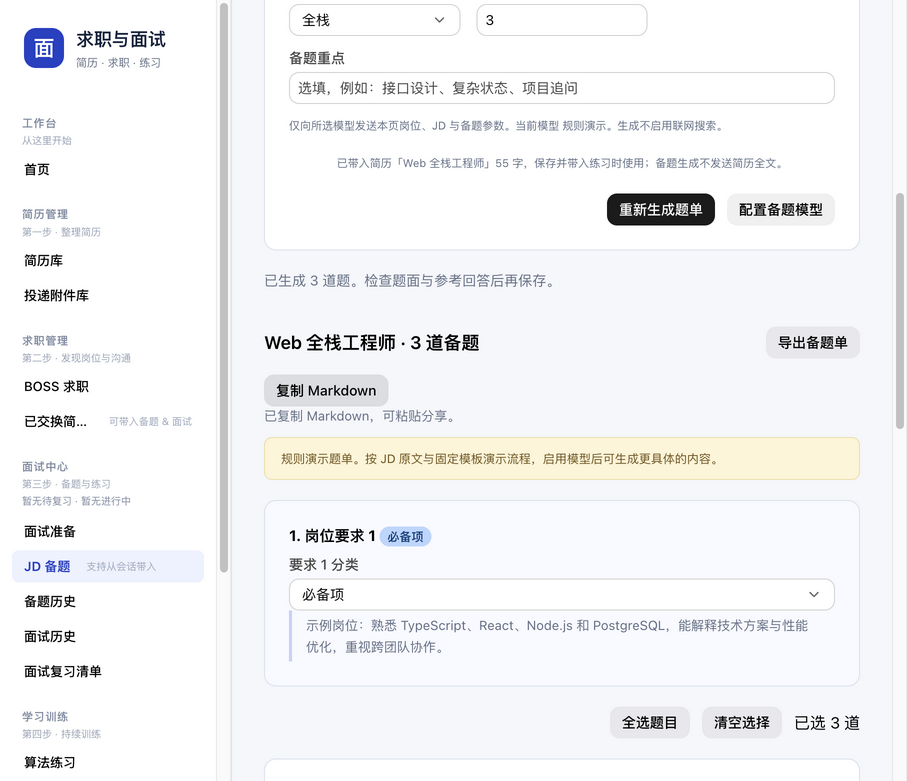

# 练习生成与 Markdown 分享验收

日期：2026-11-15。对应 REQ-006、REQ-014。

## 故障与修复

本机练习在开场作答后进入 failed，答案仍保存在 recovery 中。API、Agent、网页监听进程均来自当前项目，没有复用其他服务的端口。使用已有失败请求重放 Agent 生成接口，修复前得到 HTTP 503 / GENERATION_FAILED。进一步通过真实 SDK 路径确认错误为 `STRUCTURED_OUTPUT_TRUNCATED`，`finishReason=length`。

原练习评分最多输出 1,600 token，且评分字段主要依赖结构化输出处理器，提示内未明确给出完整契约。修复将输出预算调整为 8,192 token，并在请求中明确给出本轮输出 schema：首次不评分，有计划时必须有 evaluation，旧模式必须有 dimensions；开场、反问、HR 和非技术岗的技术评分为 null。模型只生成问题正文、能力点和类型，题库元数据继续由服务端固定。新增简洁输出约束，短答案照常评分，保留原文依据验证。

截断、超时、格式或必填字段错误、伪造作答原文、上游服务异常与内容限制分别返回公开错误码和恢复提示；不向浏览器暴露供应商响应、密钥或用户资料。自定义连接的超时信号也参与错误分类。

修复后，同一份本机失败请求在 `auto/deepseek-v4.1-flash` 真实连接上得到 HTTP 200，同时包含 assessment 和下一题。该检查通过 Agent 的幂等 receipt 保存结果，没有修改已有练习状态、答案或模型连接。原页面可刷新后显式选择当前模型重试本轮；不会直接向业务表写入评分或自动推进用户练习。

公开记录不包含这场练习的简历、JD、作答、身份或连接凭据。

## Markdown 分享

JD 备题编辑页与成功的备题历史记录均提供“复制 Markdown”。编辑页复用下载备题单的同一个 Markdown 字符串，保留编辑后的题目和参考回答、岗位要求及逐字依据；复制完整题单，勾选只控制入库和带入练习。历史复制原始生成快照，编辑不覆盖历史。

剪贴板写入成功有状态反馈；权限被拒绝或接口不可用时，展示只读全文，允许手动全选复制。输入、题单与历史均保留。

## 验证

| 检查 | 结果 |
| --- | --- |
| `pnpm build` | 通过，含类型检查、运行时注册表检查和 skill 校验 |
| `node node_modules/vitest/vitest.mjs run` | 278 通过，146 按默认配置跳过 |
| `RUN_INTEGRATION=1 node node_modules/vitest/vitest.mjs run tests/models.test.ts tests/preparation.integration.test.ts tests/generation-failure.test.ts` | 36 通过，使用隔离临时 SQLite 和本地模型协议 fixture |
| Playwright：interview、preparation、preparation-history | 8/8 通过 |
| Playwright：补验历史复制和 JD 编辑页复制 | 4/4 通过 |
| 本机真实失败请求重放 | 503 → 200，实际模型评分及下一题返回 |
| Orca 浏览器 | 合成题单生成后点击复制，观察成功状态并检查截图 |
| `git diff --check` | 通过 |

新增回归覆盖：低输出预算导致截断、显式评分契约、短答案的计划评分、截断提示与作答保留、显式重试只追加一个轮次。原有伪造依据测试继续拒绝不可核对的引用。错误分类测试覆盖长度、内容限制、鉴权、限流、超时、上游异常和结构错误。

浏览器测试实际授予剪贴板权限并读取复制后的文本，断言与下载 Markdown 完全相同，再模拟写入被拒绝并核对手动复制全文；历史复制包含原岗位、最后一道题和 JD 依据。桌面、390px 移动布局及练习失败恢复继续通过。

默认单测跳过的集成套件不算通过；上表明确列出的三组集成测试已单独启用。Vite 仍有原有大文件分块提示，正式构建成功。本轮未执行真实 BOSS 操作，未提交或推送 Git，现有本机服务保持运行。
