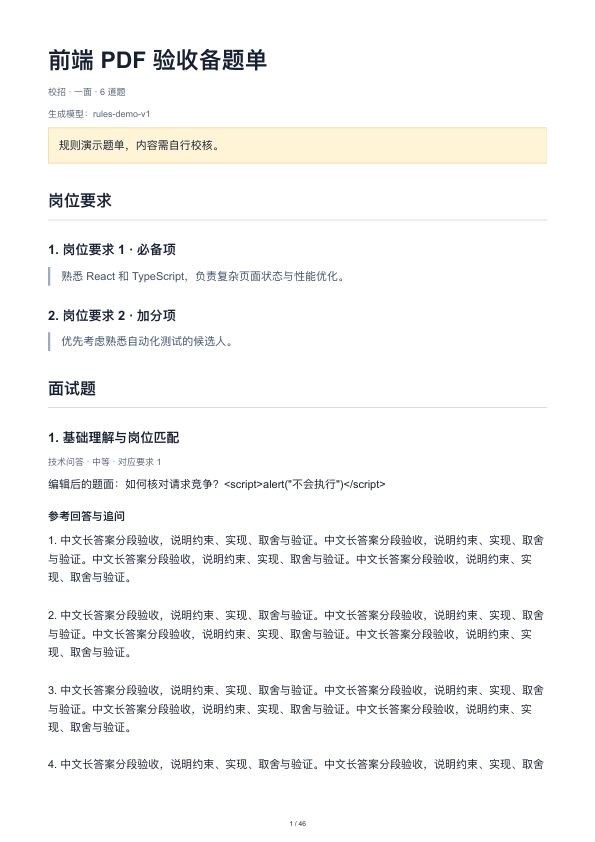
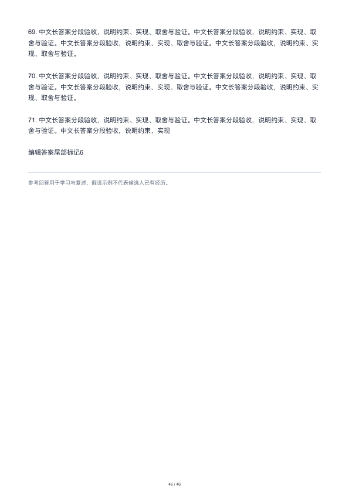

# JD 备题 PDF 导出验收

日期：2026-11-15。对应 REQ-014。

## 使用方式与范围

- JD 备题编辑页点击“导出 PDF”，下载当前题单的题面、编辑后的参考回答与追问、岗位要求和 JD 原文依据；勾选仅控制入库和练习，导出始终包含完整题单。
- 备题历史中成功的记录提供“导出 PDF”，使用当次生成的原始快照。后续编辑不覆盖历史内容，失败或生成中的记录没有导出入口。
- PDF 在本机生成，包含中文、题目编号、生成模型、演示标识、A4 分页和页码，不调用模型。导出过程中显示加载状态并阻止重复点击，失败显示错误且保留输入与题单。

本轮按用户后续指示忽略 JSON 光标异常；相关实验修改已撤回，保留原编辑逻辑。

## 实现边界

共享导出契约位于 `packages/contracts/src/preparation.ts`，限定输入、题单、编辑字段、题量和长度。编辑页将当前快照提交给 NestJS 的 `POST /api/v1/preparations/pdf`；历史使用 `GET /api/v1/preparations/history/:id/pdf`，服务端先检查归属和成功状态。编辑页导出仍受本站身份及 Origin 校验保护。

HTML 逐字段转义用户与模型内容，不执行 Markdown 中的 HTML；PDF 引擎关闭页面脚本和外部网络、阻止资源请求，30 秒后关闭。复用简历 PDF 的本机 Chromium/Chrome 引擎，不增加外部转换服务。历史和下载响应设置 `application/pdf`、UTF-8 文件名、`Cache-Control: no-store` 与 `nosniff`。

导出接口有独立 2 MB JSON 上限，支持多道完整中文长答案；题单结构、数量与 JD 逐字依据在生成前再次验证。此导出接口不会修改题库、历史或练习状态。

## 验证结果

| 验证 | 结果 |
| --- | --- |
| `pnpm build` | 通过，含类型检查、能力注册表及 skill 校验 |
| `node node_modules/vitest/vitest.mjs run` | 280 通过，146 按默认配置跳过 |
| 浏览器：preparation、preparation-history、preparation-pdf、resume-studio | 10/10 通过 |
| 编辑页实际下载 | 6 道题，编辑后长答案 46 页；每题尾部标记和最后说明均完整 |
| 历史页实际下载 | 原始题单 5 页，不包含编辑后的答案标记 |
| 文本与分页复核 | 两份 PDF 全部页面为 A4，所有提取文字边界均在纸张内；PyMuPDF 能还原中文题面 |
| 视觉复核 | 已渲染并查看编辑稿首、中、末页及历史首、末页，中文、段落、页码和页边距正常 |
| HTTP 边界 | 大于 128 KB 的真实导出请求成功；空载荷 400、非法 Origin 403、其他身份历史导出 404，下载无缓存 |
| 原简历 PDF | 绿色主题、PDF 导出、原附件字节一致性等原有浏览器回归继续通过 |
| `git diff --check` | 通过 |

浏览器测试直接读取下载的 PDF，核对题面、每题长答案尾部、历史原文和演示标识；输入的 `<script>` 作为普通文字保留，不执行。PDF.js 抽取兼容汉字时用 NFKC 规范化进行比较，另用 PyMuPDF 检查原始中文映射，避免把抽取器的字符规范化误当成缺字。

默认跳过的集成套件未计作通过；本轮浏览器使用完整的 API、Agent、Worker、临时 SQLite 和合成资料。未读取真实简历或调用收费模型，未执行 BOSS 操作，未提交或推送 Git。本机既有服务保留。

样本仅包含合成题目与长答案，PDF 中出现的编号和页数不代表真实用户经历或交付项目数量。构建保留原有 Vite 大文件分块提示。
