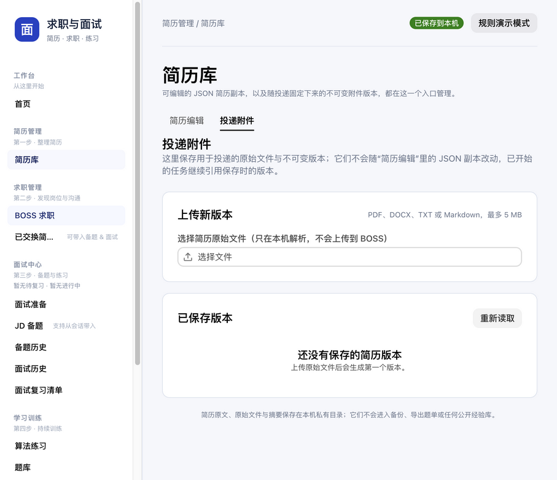
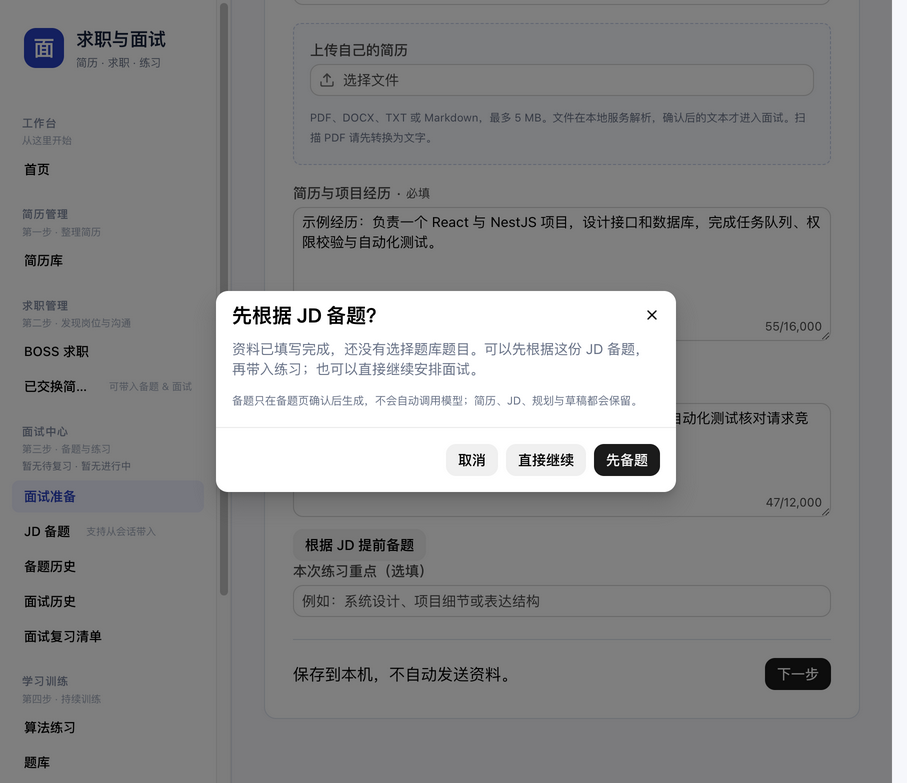
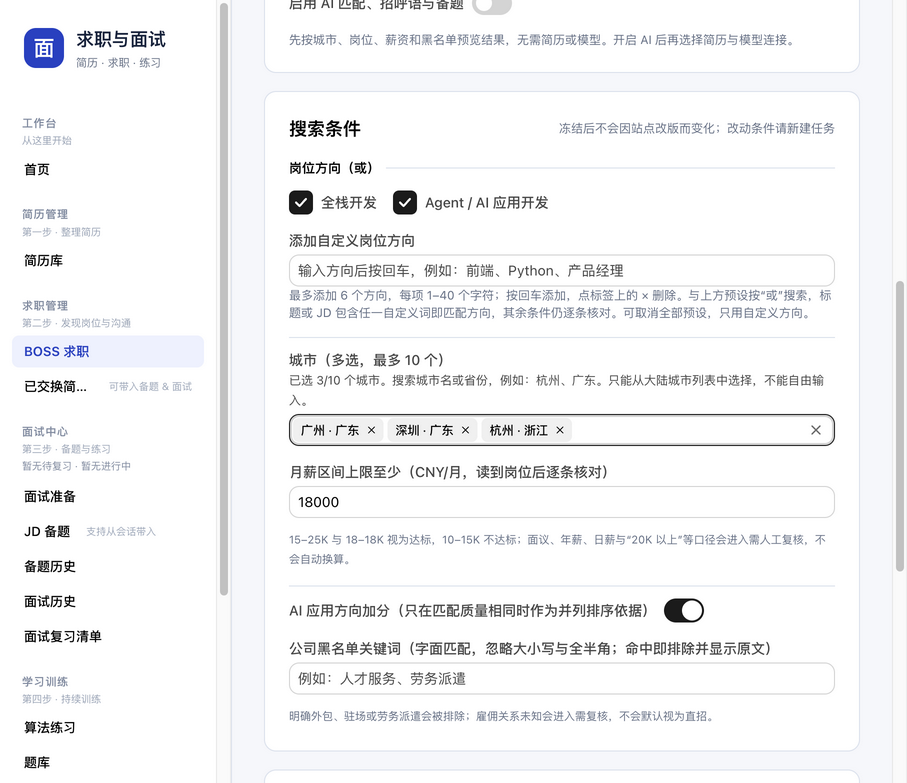

# 简历、备题与城市选择统一验收

日期：2026-11-17。需求：REQ-064、REQ-065、REQ-066，先更新 spec 并生成计划和上下文，再实施。

## 交付结果

1. 左侧和手机菜单只保留一个“简历库”。库内用“简历编辑 / 投递附件”两个标签管理 JSON 副本和不可变投递版本；旧 `#/settings/resumes` 归一到 `#/resumes/attachments`。上传、校正、原文件下载、删除确认、JSON 发布 PDF 投递版本均复用原服务。已有数据库、附件原字节及旧任务引用没有迁移或重写。
2. 有效面试资料进入安排前，按岗位、JD、级别、轮次、类型、方向及已选题单判断是否提供“先根据 JD 备题？”；可先备题或直接继续，取消保留输入。同一资料已处理的选择可恢复；更改资料后重新判断。已带入当前资料的严格题单不重复引导。进入备题页仅带入资料，仍需明确点击生成；不会因导航自动调用模型。
3. BOSS 搜索城市可按城市或省份搜索、多选和删除标签，1–10 个，默认广州/深圳。基于官方配置接口的 337 个大陆城市选项，站点编码、共享契约、搜索 URL 和本地过滤共用同一份快照。任务冻结选中城市；省份、未知值、重复城市不能作为新任务的合法城市。

城市源：[BOSS 官方公开城市配置](https://www.zhipin.com/wapi/zpCommon/data/city.json)，本轮实际获取 `code=0`。快照元数据含来源、日期及原始响应 SHA-256；主代理另行计算并确认摘要一致。站点城市代码不代表已经观察到原生筛选控件或真实搜索结果。

## pi 分工与主代理验收

三组均实际通过 `pi --provider magpie --model auto/deepseek-v4.1-flash --no-mcp --no-extensions` 实施，session 的 `model_change` 均已核对 provider/model。完整任务日志保留在本机 `/tmp/interview-workflow-20261117/`。

| 分组 | 工作 | pi session |
| --- | --- | --- |
| A | 统一简历入口、标签、路由、首页与导航 | `01a1e592-82cb-71c2-8ca6-89e85745a05d` |
| B | 条件备题判断、选择恢复、对话框与测试 | `01a1e592-8738-73d1-8f50-0971047074ff` |
| C | 官方城市快照、契约、URL、逐岗过滤和多选 | `01a1e592-8bc5-7189-a73d-60670f969ad7` |

主代理独立复核并修正：Node 的 JSON 模块导入属性；简历副本返回所用存储键的白名单与 UUID 契约；附件校正页跨标签保留；备题判断包含岗位类型；原主动备题按钮也记录处理选择；Astryx Dialog 的布局组合；测试按实际字段说明区、抽屉关闭与新菜单路径定位。简历引用键属于敏感工作区数据，默认备份不包含它。

## 验证

| 检查 | 结果 |
| --- | --- |
| `pnpm build` | 通过，含类型检查、运行时能力校验及 skill 验证 |
| `node node_modules/vitest/vitest.mjs run` | 310 通过，146 按默认配置跳过 |
| `RUN_INTEGRATION=1 node node_modules/vitest/vitest.mjs run tests/career-commands.integration.test.ts tests/career-city-snapshot.test.ts tests/preparation.integration.test.ts` | 18 通过 |
| `pnpm test:e2e:workflow` | 36/36 通过（2.6 分钟，单次完整运行） |
| `pnpm exec astryx doctor --built dist/web --json` | 0 failed；11 pass、1 warn、12 info |
| `git diff --check` | 通过 |

浏览器使用独立 API、Agent、Worker、网页端口与临时 SQLite，所有简历、题单、聊天和模型协议数据均为合成 fixture；BOSS 自动化关闭。覆盖：

- 一个简历菜单、桌面/手机标签、旧链接、刷新、前进后退、上传校正草稿、原文件 SHA-256、删除确认、JSON 发布到附件后返回原副本；原 JSON 编辑与 PDF 导出回归继续通过。
- 无效资料不引导，取消/Escape 不丢输入，直接继续和先备题的选择恢复、不同 JD 重新判断、已有严格题单往返；监听确认进入备题页没有生成请求。
- 城市名/省份搜索、删除、未知自由文本拒绝、空选择、十城上限；另用真实业务 Service + 临时 SQLite 确认杭州/成都写入冻结快照，命令幂等、旧任务城市及 owner 隔离保持。URL 编码和位置原文依据有独立单测。
- 面试提交/报告/恢复、备题历史、Markdown/PDF、聊天带入、菜单键盘操作和部署禁用传播。

Astryx 的一条 warning 为默认代理文档路径未安装托管块；本轮将版本匹配的指引写到 `docs/design/astryx-agent.md`，保留原项目 AGENTS.md。CLI 与 Core 均为 0.7.16，构建使用 Astryx 的检查通过。Vite 保留原有大块文件提示，构建成功。

## 范围

原有本机 API、Agent、网页服务保留；API 在源文件变化时由既有 watch 机制重载。没有读取真实简历、清理用户数据库、修改模型凭据或运行真实 BOSS 搜索/投递。真实 BOSS 原生城市面板、账号风控和外发未在本轮验证，career.boss 的 planned 成熟度未升级。默认跳过的 146 项测试不算通过。未提交或推送 Git。

