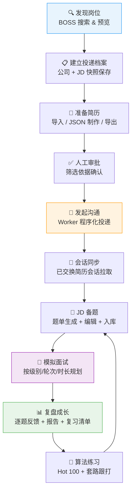
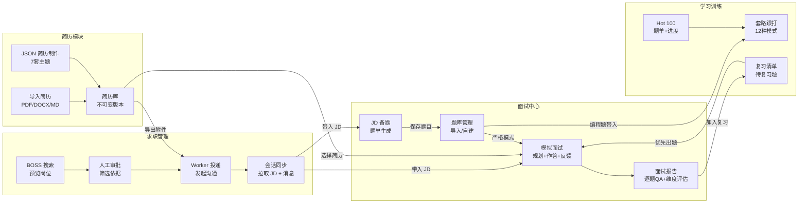

# 面试练习室 · 产品定位整改单

> **文档性质**：产品体验与信息架构整改建议
> **整改目标**：从"面试自习室"的单点工具认知，升级为"全流程求职面试工具"的完整产品定位
> **当前版本**：v0（2026-11-14）

---

## 一、核心问题诊断

### 1.1 定位错位

当前 README 首句为：

> "一个本地运行的 AI 求职与面试练习工具"

用户心智模型止步于"练习"二字，把产品等同于刷题网站或模拟面试房间，而**实际能力覆盖求职全链路**：从发现岗位 → 建立投递档案 → 制作简历 → 备题 → 模拟面试 → 复盘成长，形成完整闭环。

### 1.2 功能孤岛

各功能入口分散在左侧菜单，用户无法感知"这些功能是联动的"——JD 可以直接带入备题，备题可以直接带入模拟面试，会话同步可以打通从 BOSS 聊天到面试准备的全程，但这个连接关系从未被明确告诉用户。

### 1.3 核心差异点未被放大

| 维度 | 普通面试练习工具 | 本产品实际能力 |
|------|--------------|--------------|
| 起点 | 用户自己找题 | BOSS 岗位搜索 → 自动拉取 JD |
| 准备 | 刷题背题 | JD 驱动备题 + 题库管理 |
| 简历 | 无 | 多格式导入 + JSON 简历制作 + 主题导出 |
| 面试 | 单轮问答 | 按级别/轮次/时长规划 + 动态重规划 |
| 投递 | 无 | 明确审批后程序化发起 BOSS 沟通 |
| 成长 | 无记录 | 面试复盘 + 算法进度 + 备题历史 |

---

## 二、产品全流程梳理

### 完整求职漂亮闭环



### 各阶段工具对照

| 阶段 | 功能模块 | 关键交互 | 数据流出 |
|------|---------|---------|---------|
| **1. 岗位发现** | BOSS 求职 → 搜索预览 | 选城市/方向/薪资 → 启动预览 | 岗位快照 + 筛选依据 |
| **2. 简历准备** | 简历管理 / JSON 简历制作 | 导入文件 → 校正 → 保存库 | 不可变版本 → 投递附件 |
| **3. 投递审批** | BOSS 求职 → 人工复核 | 查看依据 → 明确批准 | 冻结投递列表 |
| **4. 发起沟通** | BOSS 求职 → Worker 执行 | 一键串行投递 | 沟通状态 + 结果 |
| **5. 会话跟进** | BOSS 会话同步 | 手动触发 → 自动同步前 10 条 | 公司/JD/消息快照 |
| **6. 面试备题** | JD 备题 / 题库管理 | JD → 生成题单 → 编辑 → 入库 | 题单 → 模拟面试 |
| **7. 模拟面试** | 面试中心 | 选简历/JD/参数 → 逐题作答 → 实时反馈 | 报告 → 复习清单 |
| **8. 算法强化** | 算法练习 | Hot 100 → 套路识别 → 跟打默写 | 进度 + 笔记 |
| **9. 复盘成长** | 面试历史 / 备题历史 | 查看报告 → 加入复习 → 重新练习 | — |

---

## 三、交互流程整改方案

### 3.1 首页：用「旅程地图」替代「功能列表」

**现状**：首页用表格罗列功能，用户扫一眼就跳过。

**整改方案**：首页增加「求职旅程」可视化引导区，按阶段展示"你现在在哪一步"，每步高亮可进入的功能：

```
╔════════════════════════════════════════════════════════╗
║  你的求职进度                                           ║
║                                                        ║
║  [发现岗位] → [准备简历] → [投递审批] → [会话跟进]        ║
║       ↓                                     ↓          ║
║  [JD备题] ←←←←←←←←←←←←←←←←←←←←←←←←←←← ←           ║
║       ↓                                                ║
║  [模拟面试] → [复盘报告] → [算法练习] → 下一轮          ║
╚════════════════════════════════════════════════════════╝
```

### 3.2 左侧菜单：增加阶段分隔与流程提示

**现状**：五个菜单组（简历、求职、面试、学习、设置）之间无流程连接感。

**整改方案**：在每个菜单项旁增加「→ 下一步」流向提示，或在菜单头部显示当前阶段。

```
▌ 简历管理         ← 第一步：准备好你的简历
  · 简历库
  · JSON 简历制作
  · 简历主题导出

▌ 求职管理         ← 第二步：找到目标岗位
  · BOSS 岗位搜索
  · 投递审批
  · 已交换简历会话   ← 拉取后可直接带入 →

▌ 面试中心         ← 第三步：备战与练习
  · JD 备题         ← 可从会话/简历库直接带入
  · 模拟面试        ← 可从备题直接带入题库
  · 面试历史
  · 备题历史

▌ 学习训练         ← 第四步：持续提升
  · Hot 100 题单
  · 算法练习
  · 套路跟打
  · 题库管理
```

### 3.3 核心联动入口整改

以下是产品**最有价值但最不明显**的联动路径，需要在界面上明确标注：

#### 联动路径 A：BOSS 会话 → 面试准备（最强差异点）

```
已交换简历会话详情页
  ├── [查看 JD]
  ├── [选择简历] ← 简历库 JSON 副本
  ├── [→ JD 备题]   ← 点击直接带入岗位+JD+参数
  └── [→ 模拟面试]  ← 点击直接带入岗位+JD+简历
```

**整改要求**：
- 会话详情页的「带入备题」「带入面试」按钮应放在首屏可见位置，而非隐藏在操作区
- 点击前需展示"将带入以下内容"预览确认弹窗

#### 联动路径 B：JD 备题 → 题库 → 模拟面试（闭环练习）

```
JD 备题
  → 编辑题目 → 批量入库
  → [保存并带入练习] ← 严格模式，原题不改
       ↓
  模拟面试（严格题库模式）
       ↓
  面试报告 → [加入复习清单]
       ↓
  下次模拟 → 优先复习清单题目
```

**整改要求**：
- 「保存并带入练习」流程加入简明文案说明："这些题将原样出现在面试中"
- 面试报告「加入复习清单」按钮需放在每题反馈旁，而非只在报告汇总页

#### 联动路径 C：简历库 → 多场景使用

```
简历库（JSON 副本）
  ├── [导出 PDF]        → 投递附件
  ├── [带入模拟面试]    → 面试准备
  ├── [带入 JD 备题]    → 备题页
  └── [保存为投递版本]  → 冻结不可变版本 → BOSS 投递
```

**整改要求**：
- 简历库卡片操作区应将「带入面试」「带入备题」与「导出 PDF」并列
- 明确标注哪个版本是"已投递版本"（冻结标记）

### 3.4 状态感知与进度持久化

**现状**：用户关闭页面后不清楚"我上次做到哪了"。

**整改方案**：在左侧菜单或顶部增加「今日进度」轻量提示：

```
面试中心
  · 备题历史：昨天生成了 1 份，状态：成功 ✓
  · 模拟面试：上次：前端工程师一面（2026-11-13）→ [继续复盘]
  · 复习清单：3 题待复习
```

---

## 四、文案定位整改

### 4.1 产品口号重写

| 场景 | 现有文案 | 整改建议 |
|------|---------|---------|
| README 首句 | "一个本地运行的 AI 求职与面试练习工具" | "从找岗位到拿 Offer，全流程 AI 求职助手，数据本地保存" |
| 首页 Hero 区 | 无 | "BOSS 找岗 → 简历制作 → 备题练习 → 模拟面试 → 复盘成长，一站搞定" |
| 功能表格标题 | "功能特性" | "覆盖求职全流程的 9 大模块" |

### 4.2 功能描述重写优先级

以下功能描述需要优先改写，以体现联动价值而非单点能力：

**JD 备题**（现状描述不完整）：
> 现有：提前生成带原文依据的题单，保留备题历史并支持失败重试，编辑后保存到题库或带入面试。

> 建议：**基于 JD 自动生成备考题单**：粘贴 JD 即可生成 3-12 道题，区分必备项与加分项，每题带原文依据。编辑后一键入库，或直接带入模拟面试以原题形式练习。从 BOSS 会话 JD 一键进入，历史记录可回看和重试。

**BOSS 求职**（现状顺序混乱）：
> 建议重新排序，按"搜索 → 筛选 → 审批 → 投递 → 会话跟进"顺序描述，突出"明确审批后才投递"的合规设计。

### 4.3 「规则演示」标注优化

现有描述：在首次使用引导中提及"规则演示不调用真实模型"。

整改：在每个需要 AI 的功能入口旁，统一展示「模式标识」：

```
[演示模式] 当前使用规则生成，不调用 AI
[AI 模式 ✓] 使用：gpt-4o-mini（OpenAI）
```

---

## 五、菜单结构与信息架构整改

### 5.1 当前问题

- "面试准备"和"面试历史"在同一菜单组，但"JD 备题"也算面试准备——分组边界模糊
- "BOSS 求职"下的"已交换简历会话"是求职管理，也是面试准备的入口——双重归属

### 5.2 建议调整（最小改动原则）

在不改变现有路由结构的前提下，通过以下方式改善：

1. **在「求职管理」→「已交换简历会话」菜单项旁加标注**：`可带入备题 & 面试 →`
2. **在「面试中心」→「JD 备题」菜单项旁加标注**：`可从 BOSS 会话/简历库直接带入`
3. **新增「快速开始」入口**（面向新用户），提供两条路径选择：
   - 「我已有岗位 JD」→ 直接进 JD 备题
   - 「我需要先找岗位」→ 进 BOSS 求职

---

## 六、整改优先级与工作量评估

### P0：必改（影响用户认知，低工作量）

| 编号 | 整改项 | 预估工作量 |
|------|-------|----------|
| P0-1 | README 首句和功能表格文案重写 | 0.5h |
| P0-2 | 会话详情页「带入备题」「带入面试」按钮置顶 | 1h |
| P0-3 | JD 备题页「保存并带入练习」流程说明文案 | 0.5h |
| P0-4 | 模式标识（演示/AI）统一展示 | 2h |

### P1：重要（提升连贯体验，中工作量）

| 编号 | 整改项 | 预估工作量 |
|------|-------|----------|
| P1-1 | 左侧菜单增加阶段说明文字 | 2h |
| P1-2 | 简历库卡片增加「带入面试」「带入备题」快捷操作 | 3h |
| P1-3 | 面试报告每题旁增加「加入复习清单」按钮 | 2h |
| P1-4 | 首页增加求职旅程引导区 | 4h |

### P2：加分（强化产品感，较高工作量）

| 编号 | 整改项 | 预估工作量 |
|------|-------|----------|
| P2-1 | 左侧菜单「今日进度」轻量提示 | 4h |
| P2-2 | 新用户「快速开始」引导流程 | 6h |
| P2-3 | 求职旅程进度可视化组件 | 8h |

---

## 七、验收标准

### 体验验收

- [ ] 新用户打开首页 10 秒内能理解"这是个完整求职工具，不只是练习题"
- [ ] 从 BOSS 会话到模拟面试，操作步骤 ≤ 3 次点击（会话详情 → 选简历 → 带入面试）
- [ ] 从 JD 备题到严格模式面试，全程不需要重新填写 JD 或参数
- [ ] 每个功能页面顶部有面包屑或阶段提示，用户知道"我在哪一步"

### 文案验收

- [ ] README 中不出现"练习工具"单独描述，统一使用"求职助手"或"全流程工具"
- [ ] 功能描述中明确提及与其他模块的联动关系（备题 ↔ 面试，会话 ↔ 准备）
- [ ] 「演示模式」与「AI 模式」在每个相关功能入口均有明确标识

### 流程验收

- [ ] 完整走通「BOSS 搜岗 → 人工审批 → 投递 → 会话同步 → 带入备题 → 模拟面试 → 查看报告」全链路，各步骤间有明确的"下一步"引导
- [ ] 简历库中的 JSON 副本可在同一页面内完成「预览 → 选主题 → 导出 PDF → 带入面试」四个动作

---

## 附：产品全链路数据流图



---

> **整改单版本**：v1.0
> **整理者**：Antigravity
> **参考文档**：[README.md](file:///Users/gooingyu/orca/workspaces/interview-agents/自检/README.md) · [user-guide.md](file:///Users/gooingyu/orca/workspaces/interview-agents/自检/docs/user-guide.md) · [boss-workflow.md](file:///Users/gooingyu/orca/workspaces/interview-agents/自检/docs/boss-workflow.md) · [boss-conversations.md](file:///Users/gooingyu/orca/workspaces/interview-agents/自检/docs/boss-conversations.md)
